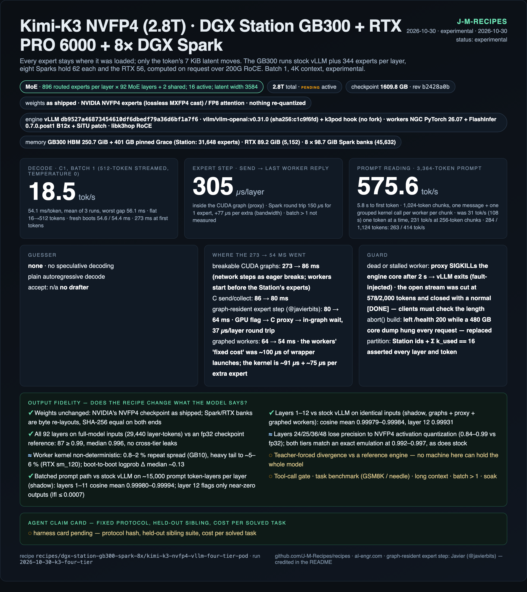

# Kimi-K3 NVFP4 across four memory tiers — DGX Station GB300 + RTX PRO 6000 + 8× DGX Spark

**Status: experimental (2026-10-30).** Batch-1 decode at **18.5 tok/s** (54.1 ms/token, flat 16→512 tokens).
Prompt reading **576 tok/s** (a 3,364-token prompt reaches its first token in 5.8 s; 31 tok/s before batching).
Every MoE layer checked against the checkpoint; no model-level quality gate yet (see [Known limits](#known-limits)).



## What this runs

NVIDIA's NVFP4 release of Kimi-K3 (2.8T-parameter MoE, 1.61 TB checkpoint, 82,432 routed experts) is bigger than
any machine here. Instead of moving weights, each expert stays where it was loaded and only the token's 7 KiB
latent moves:

| tier | experts per MoE layer | total | computed by |
|---|---:|---:|---|
| GB300 HBM + pinned Grace (Station) | 344 | 31,648 | stock vLLM 0.31.0, TRT-LLM NVFP4 routed-MoE kernel |
| RTX PRO 6000 Max-Q (Station) | 56 | 5,152 | expert worker, FlashInfer B12x (sm_120) |
| 8× DGX Spark | 62 each | 45,632 | expert worker, FlashInfer B12x (sm_121) |

The GB300 runs everything that is not a routed expert (attention — 69 KDA + 24 MLA layers — router, two shared
experts, lm_head). For every MoE layer it hands each worker the token's latent, the 16 routed ids and weights over
200G RoCE; a worker computes the experts it holds and returns one 7 KiB row; the Station adds the rows to its own
share. The partition is asserted on every layer and token (`Station ids + Σ k_used == 16`).

How the 54 ms is reached (all receipts in `results/2026-10-30-k3-four-tier/`):

| config | ms/token |
|---|---:|
| eager, first tokens | 273.4 |
| vLLM breakable CUDA graphs, network steps as eager breaks, workers started before the Station's experts | 86.1 |
| send/collect in C | 79.9 |
| **graph-resident expert step** — GPU writes a ready flag, a C proxy thread sends/collects, the graph waits on a done flag (`cuStreamWriteValue32` / `cuStreamWaitValue32`); idea from Javier ([@javierbits](https://x.com/javierbits/status/2116280163637854396)) | 63.7 |
| **graphed workers** — one CUDA graph per (layer, expert count) on every worker (the "fixed cost" was ~100 µs of wrapper launches, not the kernel) | **54.1** |

No vLLM fork: `scripts/engine/k3pod.py` is loaded by `sitecustomize.py` from a bind mount.

## Hardware

Profile: [`hardware/dgx-station-gb300-spark-8x.yaml`](../../../hardware/dgx-station-gb300-spark-8x.yaml).

- **DGX Station GB300**: 250.7 GiB HBM visible, 494.5 GiB Grace; the engine pins 401 GB of Grace for the
  Station's packed experts (`--cpu-offload-gb 401`). Grace runs at 493/494 GiB with the model up.
- **RTX PRO 6000 Max-Q** in the Station: 89.2 GiB bank; exposed to containers by CDI, pinned by UUID.
- **8× DGX Spark (GB10)**: one 98.7 GiB bank each (105,977,358,016 bytes), resident.
- **Fabric**: two MikroTik CRS804-4DDQ. Station (both 200G ports) and Sparks 1–4 on switch B, Sparks 5–8 on switch A,
  400G between. 7 KiB half-RTT 4.7 µs (same switch) / 5.9 µs (across).
- **Power**: Station on a dedicated 20 A circuit (estimated 1,685 W at load).

Snapshots of all nine machines: `results/2026-10-30-k3-four-tier/system/`.

## Software

| piece | pin |
|---|---|
| engine image | `vllm/vllm-openai:v0.31.0@sha256:c1c9f6fd…7c3` (stock, pullable) |
| engine hook | `scripts/engine/k3pod.py` (sha256 `3ba58703…`), `scripts/engine/sitecustomize.py` |
| worker image | `nvcr.io/nvidia/pytorch:26.07-py3@sha256:3b0a5c3a…521` (stock) |
| worker env | venv with `flashinfer-python==0.7.0.post1` + [`patches/b12x-situ.patch`](patches/b12x-situ.patch) (Kimi-K3's SiTU-GLU activation in the B12x MoE kernels) — `scripts/setup-worker-venv.sh` |
| transport | `scripts/worker/k3hop.c` → `libk3hop.so` (ibverbs RC, zero-copy registered ring; C fast path; graph-resident proxy) |
| worker | `scripts/worker/worker.py`, `k3proto.py` |
| model | `nvidia/Kimi-K3-NVFP4` @ `b2428a0b83a8b712ff2e1a8448a103d4175341f1` (experts NVFP4, cast losslessly from MXFP4 per NVIDIA's `conversion_report.json`; attention FP8 per-block) |
| plan | `scripts/build/plan-4tier-v1.json` (Sparks uniform 62/layer, seed 20261030; RTX 56/layer, seed 20261031; Station = the rest) |

## Launch

One-time, per host:

```bash
# every Spark and the Station: worker env + transport
K3_DIR=$HOME/k3pod bash scripts/setup-worker-venv.sh
mkdir -p $HOME/k3pod/a3 && cp scripts/worker/{worker.py,k3proto.py,k3hop.c} scripts/run-worker-*.sh \
   scripts/build/plan-*.json $HOME/k3pod/a3/
gcc -O2 -Wall -shared -fPIC -o $HOME/k3pod/a3/libk3hop.so $HOME/k3pod/a3/k3hop.c -libverbs -lpthread

# Station: build the nine banks from the checkpoint (byte re-layout, ~2.5 min each), stage spark banks to each
# Spark's ~/k3/banks, keep rtx0 local; verify SHA-256 on both ends
for t in spark0 spark1 spark2 spark3 spark4 spark5 spark6 spark7 rtx0; do
  python3 scripts/build/k3_bank_build.py --ckpt /models/kimi-k3/nvidia-nvfp4-b2428a0b \
    --plan scripts/build/plan-4tier-v1.json --target $t --out-dir /models/kimi-k3/banks/$t
  python3 scripts/build/k3_bank_verify.py --bank /models/kimi-k3/banks/$t/k3bank-$t.ldb \
    --plan scripts/build/plan-4tier-v1.json --target $t
done

# Station: engine hook
mkdir -p $HOME/k3-engine && cp scripts/engine/*.py $HOME/k3-engine/
```

Every boot (workers accept one engine connection per start, so always restart them first):

```bash
SPARK_HOSTS="s1 s2 s3 s4 s5 s6 s7 s8" STATION=station RTX_UUID=GPU-... bash scripts/start-workers.sh
GB300_UUID=GPU-... MODEL_DIR=/models/kimi-k3/nvidia-nvfp4-b2428a0b bash scripts/launch-engine.sh
# ~7 min load + ~12 min FlashInfer autotune; API on 127.0.0.1:30023, model name "k3"
```

`start-workers.sh` passes `RTX_UUID` to `run-worker-rtx.sh` on the Station.

## Verify

```bash
python3 scripts/check/k3pod_probe.py 30023 probe.json        # 3 greedy prompts, coherent text
python3 scripts/check/bench.py 30023 128 3                    # expect ~54-55 ms/token
python3 scripts/check/prefill_bench.py 30023 run1             # prompt reading; expect ~575 tok/s at 3,364 tokens
docker logs k3-pod-n93 2>&1 | grep "proxy:"                   # 'mean proxy work ~305 us' per layer
```

Parity (optional, needs the GB300 to itself):

```bash
# layers 1-12 vs stock vLLM on identical inputs (every expert of those layers in HBM)
N=13 K3POD_SHADOW=1 K3_GPU_UTIL=0.95 PORT=30021 bash scripts/launch-engine.sh   # then send traffic; read k3-out/shadow-n13.json
# all 92 layers vs an fp32 reference from the checkpoint
EAGER=1 K3POD_PROXY=0 K3POD_DUMP_DIR=/pod/dump bash scripts/launch-engine.sh  # send 5 prompts x 64 tokens, stop the engine, then:
#   run inside vllm/vllm-openai:v0.31.0 on the GB300 with -v $MODEL_DIR:/ckpt:ro -v scripts/check:/situ:ro
#   (ref_expert.py); one fresh process per 15-layer batch (a single run was OOM-killed after 36 layers)
python3 scripts/check/pod_ref_check.py DUMP_DIR scripts/build/plan-4tier-v1.json out.json 10000 LO HI
```

Fault path: kill any worker during a request — the engine container must exit within seconds. The open stream is
cut short but still ends with `[DONE]`, so check `finish_reason` / length client-side
(`results/…/raw/fault-injection/README.md`).

## Results

Run `2026-10-30-k3-four-tier`, reference box, `--max-num-seqs 1`, `--max-model-len 4096`.

**Speed** (C1, temperature 0):

| measurement | result |
|---|---:|
| 512-token streamed decode, 3 runs | 54.11 / 54.13 / 54.13 ms per token → **18.5 tok/s**, worst gap 56.1 ms |
| length sweep 16 / 64 / 128 / 256 / 512 tokens (gap p90) | 54.65 / 54.96 / 54.87 / 54.93 / 54.96 ms |
| fresh boots (22:29, 23:05) | 54.57, 54.36 ms per token |
| per layer: proxy send → last worker reply | 305 µs |
| prompt reading, 1,024-token chunks (serving), 32 / 284 / 1,124 / 3,364-token prompts (time to first token, median of 3) | 0.69 / 1.08 / 2.71 / 5.84 s → 46 / 263 / 414 / **576 tok/s** |
| prompt reading, 256-token chunks (GPU collect / CPU collect) | 3,364 tokens: 14.57 s / 15.8 s → 231 / 213 tok/s |
| prompt reading, one token per round trip (first version) | 1.26 / 9.40 / 36.4 / 108.4 s → 25 / 30 / 31 / 31 tok/s |
| worker kernel, 256-token chunk on one Spark (real weights) | one call 5.7–6.6 ms vs 37.9 ms token by token, ~1% apart (kernel noise) |
| Spark round trip (graphed worker), k = 1 / 2 / 3 / 4 | 150 / 225 / 311 / 385 µs (v1: 244 / 312 / 398 / 469) |

**Correctness**, per layer (the model-level gate is pending — see limits):

| check | result |
|---|---|
| shadow, layers 1–12 vs stock vLLM, identical inputs (graphs + proxy + graphed workers) | layers 1–11 cosine mean 0.99979–0.99984; layer 12 0.99931 |
| all 92 layers, full-model inputs (29,440 layer-tokens) vs fp32 checkpoint reference | 87/92 ≥ 0.99, median 0.996; no cross-tier leaks |
| outlier layers 24/25/36/48 vs a kernel-faithful NVFP4 emulation | both tiers 0.992–0.997 (vs fp32 0.84–0.99 — the recipe, also seen in stock) |
| greedy text, 5 prompts (EN, FR, code, arithmetic) | coherent; arithmetic correct |
| batched prompt path vs stock vLLM, ~15,000 prompt token-layers per layer (shadow, 13-layer cut) | layers 1–11 cosine mean 0.99980–0.99994; layer 12 flags only tokens whose stock output is ~0 |
| fault injection (kill a Spark worker mid-decode) | proxy trips in ~2 s, engine exits (SIGKILL build); open stream cut at 578/2,000 tokens, closed with `[DONE]` |

Receipts: `results/2026-10-30-k3-four-tier/` (`throughput.csv`, `raw/speed-transcribed.txt` — speed lines
transcribed from session output, labelled; `raw/parity/`, `raw/fault-injection/`, `raw/worker/`, `raw/probes/`,
`raw/server-logs/`, `raw/fabric/`, `system/`).

## Known limits

- **Prompt reading is 576 tok/s**, not GPU-class. Each worker gets a whole 1,024-token chunk in one message and runs
  one grouped kernel call; the GPU gathers rows and sums replies in place. At 256-token chunks the limit was the
  Station's own experts — ~270 per layer read from Grace over C2C at ~850 GB/s once per chunk — so bigger chunks
  were the lever. Chunks are capped at 1,024 (8 MiB slots). The first multi-chunk prompt after boot pays a one-time
  ~4–5 s vLLM FlashAttention JIT compile.
- **Batch kernels are compiled per padded row count.** `worker.py` builds every bucket at boot and must warm the
  dynamic kernel first; otherwise the first real chunk compiles for ~3 s.
- **Batch 1, 4K context.** `--max-num-seqs 1 --max-model-len 4096 --max-num-batched-tokens 256`. Batch 2–8 decode
  takes the same one-token path and was not measured.
- **No model-level quality gate.** No teacher-forced comparison with a reference engine, no tool-call gate, no task
  benchmark: no machine here can hold a stock copy of the whole model. Evidence is per layer (above).
- **NVFP4 precision at low-magnitude layers** (24, 25, 36, 48; layer 12 carries ~0.2 % of its input) — matched by an
  exact emulation and by stock vLLM, not specific to this recipe.
- **Non-deterministic worker kernel.** B12x repeats differ by 0.8–2 % on GB10; the RTX (sm_120) has a
  timing-dependent tail to ~5–6 % with or without graphs. Logprobs move ~0.12–0.14 (median) between boots; greedy
  text can flip at near-ties. Repro for upstream: `scripts/check/rtx_tail_check.py`.
- **A cut-off stream looks finished.** When a worker dies, the open stream stops early but still ends with `[DONE]`;
  clients must check `finish_reason` / token count.
- **Every worker is on the critical path.** One dead or stalled (> 2 s) worker SIGKILLs the engine core; recovery is
  `start-workers.sh` + a ~20 min boot. An earlier `abort()` build left a healthy-looking server that hung while
  writing a ~480 GB core dump — do not revert to it.
- **Grace is full** (493/494 GiB): no room for more Station experts or other large jobs.
- **Uniform placement.** Hot/cold placement is simulated at only 1–6 ms/token gain.
- Speed numbers are transcribed from bench stdout (labelled); parity, fault and worker receipts are original files.
- Fabric addresses and the plan-target→host map are fixed for this topology (`k3pod.py`, `start-workers.sh`).

## Rollback

`SPARK_HOSTS=… STATION=… bash scripts/stop-pod.sh` stops the engine and all nine workers; nothing is installed
system-wide. On the reference box the GB300 otherwise serves DeepSeek-V4.1-Flash
([sibling recipe](../../dgx-station-gb300/deepseek-v4.1-flash-vllm-uva-dspark-sidecar/)); restore it with that
recipe's launcher after stopping this pod — the two cannot share the GB300.

## Credits

**Mechanisms this recipe runs:**

- **Javier ([@javierbits](https://x.com/javierbits/status/2116280163637854396))** — the graph-resident expert step:
  "have the GPU set a flag, let a C++ thread do the sends and wait in the graph." Built as `k3proxy` in
  `k3hop.c` + `_proxy_issue/_proxy_finish` in `k3pod.py`; 79.9 → 63.7 ms/token.
- **NVIDIA** — the NVFP4 Kimi-K3 checkpoint (Model Optimizer), the B12x CuTe-DSL MoE kernels in FlashInfer, the
  TRT-LLM NVFP4 routed-MoE kernel, NGC PyTorch.
- **vLLM** — Kimi-K3 support, breakable CUDA graphs (`eager_break_during_capture`), UVA CPU offload.
- **Moonshot AI** — Kimi-K3.

**Measured against:** stock vLLM 0.31.0 holding every expert of a 12–13-layer cut in HBM (shadow reference), and an
independent fp32 implementation of the expert math (`scripts/check/ref_expert.py`).

Engineering: Milo (claude-opus-5-5) with James Meadlock. Write-up:
<https://al-engr.com/kimi-k3-nvfp4-station-eight-sparks.html>.
