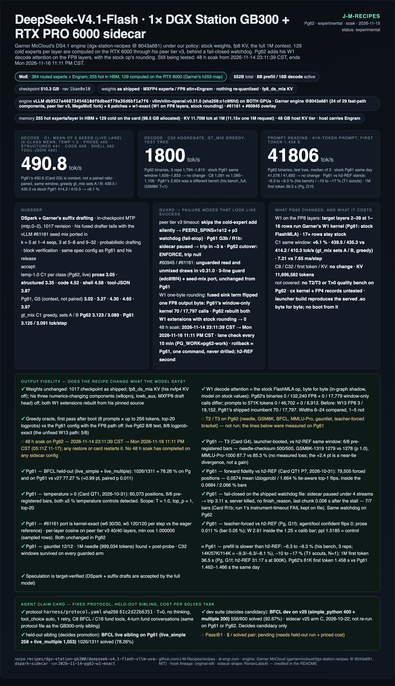

# DeepSeek-V4.1-Flash · 1M context on a DGX Station GB300 + RTX PRO 6000 sidecar

The 510 GB DeepSeek-V4.1-Flash-1017 checkpoint does not fit in one GB300. This recipe keeps the hot experts in the
GB300's HBM and moves the cold experts to the **RTX PRO 6000 Max-Q in the same box, which computes them**. Only
activations cross PCIe. The [GB300-only sibling recipe](../deepseek-v4.1-flash-vllm-uva-dspark/README.md) takes the
other road: it reads cold experts from Grace memory, which puts a serial read on every decode step.

## Status



- **Serving:** Pg62 on `:30006` of the reference box, since **2026-11-14 23:11:55 CST**. Pg62 is Pg61
  ([Garner McCloud's DS4.1 engine](https://github.com/garnermccloud/dgx-station-recipes/tree/8043a6811a5feda70fdfb6e827eebb2ec25c65d1/deepseek-v4.1-flash)
  run under our policy and patch set) plus two changes to decode attention:
  [what changed](#pg62-2026-11-14-exact-w1-decode-attention-on-the-fp8-layers).
- **Status:** `experimental`. Pg62's evidence is byte-level equality of each W1 decode-attention call against the
  stock FlashMLA op plus the 8-prompt first-pass greedy oracle. The T2/T3 quality suite ran on the live lane 2026-11-15 and passed all six
  pre-registered bars against Pg61's stored per-item results (needle-checksum EXACT 500/500, GSM8K-1319 1284 vs Pg61's 1279, BFCL held-out 1024 vs 1026 of 1,311, MMLU-Pro-1000 871 vs 877; [round](results/2026-11-15-pg62-t2-t3/README.md)).
  Pg61's 2026-10-31 release gates are Pg61's, not Pg62's. *(Corrected 2026-11-15: this said no T2/T3 bench had run
  on Pg62.)*
- **Soak:** 48 h, started 2026-11-14 23:11:39 CST (receipt: launcher `soak-start.json`); it ends
  **Monday 2026-11-16 11:11 PM CST (05:11Z 11-17)**. Any restore or card restarts the clock. No 48 h soak has completed
  on any sidecar config: no receipt in this recipe shows Pg61's last window (to 2026-11-12 5:39 AM CST) completing.
- **Rollback:** Pg61, one command on the box: `bash scripts/rollback-pg62-to-pg61.sh` (try `--dry-run` first).
  **Never drilled.** Afterwards, point the box autostart and the lane check (`PG_WORK`) back at `pg61-work` by hand.
  Second line: h2-REF, `bash scripts/rollback-pg61-to-h2ref.sh` (drilled end to end 2026-10-31).
- **Bundle:** [`results/2026-11-14-pg62-w1-exact/`](results/2026-11-14-pg62-w1-exact/README.md). Pg61's:
  [`results/2026-10-29-pg61-garner-engine/`](results/2026-10-29-pg61-garner-engine/README.md) and the release-gate
  round [`results/2026-10-31-r1-qt1/`](results/2026-10-31-r1-qt1/README.md). Pg61 card: `card-pg61.png`.
- **Related:** blogs
  [GB300 + sidecar vs 4× RTX PRO 6000 (BRRR)](https://al-engr.com/gb300-vs-4x-rtx6000-dsv41-flash-brrr.html),
  [Adaptive Residency Part 3, the seed map](https://al-engr.com/gb300-adaptive-residency-seed-map.html) and
  [Part 1, with its convergence correction](https://al-engr.com/gb300-adaptive-expert-residency.html). Peer recipe:
  [fraserprice/DeepSeek-4.1-Flash-1017-BRRR](https://huggingface.co/fraserprice/DeepSeek-4.1-Flash-1017-BRRR).
- **How we got here:** one line per round in [History](#history). The Pg61 banner this block replaced is in
  [HISTORY.md](HISTORY.md#pg61-status-banner-superseded-2026-11-15-by-pg62).

## At a glance

### Pg62 (2026-11-14): exact W1 decode attention on the FP8 layers

Pg62 runs Garner's W1 decode-attention kernel on the FP8 compressed layers (target layers 2–39, 1–16 rows), where Pg61
ran the stock FlashMLA op, and rebuilds both W1 extensions with the stock op's rounding, so every compared call writes
the stock op's bytes. Same window, same harness: **+6.1 % C1 decode**, with C8, C32, first-token time and the KV pool
unchanged.

| test tree, one window (A6 → F2 → A7, 2026-11-14) | stock Pg61 (A6, A7) | **Pg62 binaries (F2)** |
|---|--:|--:|
| C1 decode, set A / set B (tok/s, 3 reps each) | 413.88–414.72 / 409.88–410.80 | **439.36–439.57 / 435.28–435.42** (+6.1 % / +6.1 %) |
| C1 step, set A | 7.639–7.654 ms | 7.205–7.209 ms |
| tokens per step, A / B | 3.125 / 3.091 | 3.123 / 3.089 |
| C8 / C32 aggregate (tok/s) | 1,085.1–1,108.6 / 1,626.1–1,833.2 | 1,087.6–1,094.9 / 1,794.1–1,809.9 (no change) |
| first token at 32 / 1K / 8K / 64K prompt tokens (s) | 0.020 / 0.121 / 0.183 / 1.466 | 0.020 / 0.122 / 0.182 / 1.458 |
| KV pool (tokens) | 11,696,582 | 11,696,582 |

`gt_mix_drive`, greedy; sets A and B are 20 prompts × 256 tokens. The C8, C32 and first-token cells ran on the test
tree (the same two binaries); on the promoted tree the live C1-A read 439.33 tok/s at 7.214 ms/step.

| byte-equality shadow (both kernels on every call, model on stock values) | FP8 path: calls differing | window-only path: calls differing |
|---|--:|--:|
| W13 FP8 routing as written (shadow-e1) | 3 of 19,152 | — |
| Pg61's shipped incumbent `w1_attn_ext.so` 7201643d… (shadow-h1) | — | **70 of 17,797** |
| **Pg62's two binaries** (shadow-i-stockall) | **0 of 132,240** | **0 of 17,779** |
| Pg62's two binaries, prompts to 571K tokens (shadow-lc2, the cutover gate) | 0 of 46,702 | 0 of 6,913 |
| greedy oracle, 8 prompts, first pass (live Pg62, after the cutover) | 8/8 text, 8/8 logprob-exact | |

Each differing call was one output data byte, never a scale byte. So **Pg61 was never byte-equal to the stock op on
window-only layers**, and Pg62's greedy output differs from Pg61's on some prompts by design. Full tables:
[the bundle](results/2026-11-14-pg62-w1-exact/README.md).

**What a caller sees on Pg62** (live lane 2026-11-15 05:11–05:12 CST, light load, soak not restarted; the same
`caller_probe.py`). The Pg61 column is 2026-10-30: context, not a paired ratio.

| measure | Pg62, 2026-11-15 | Pg61, 2026-10-30 |
|---|---:|---:|
| single stream, 400-token reply (median of 3) | 330 tok/s (305 / 330 / 408) | 343 tok/s (303 / 343 / 346) |
| 40-token turn, complete (median of 5) | 85 ms | 91 ms |
| 8 concurrent streams × 400 tokens (median of 3) | 1,094 tok/s (847 / 1,094 / 1,097) | 1,088 tok/s (858 / 1,088 / 1,107) |
| first token, idle | 32 ms | 35 ms |
| quiet single-stream step (median inter-chunk gap) | 7.0 ms | 7.5 ms |
| worst-10 % gap while a 33K prompt is read | 149 ms | 132 ms |
| that 33K prompt's first token | 0.89 s | 0.87 s |

**Per-class C1 at temperature 1.0 on Pg62** (live lane 2026-11-15, the Card G5 instrument and prompt set, seeds
42/43/44, 0 errors, 0 foreign tokens): class mean **490.8 tok/s** — prose 405.3, structured 441.1, code 556.2,
shell_ops 561.9, tool_json 489.6; acceptance_len 3.778. Pg61's G5 read 450.6 (2026-10-29, one boot): **context, not a
paired ratio**. Different window, and this run shared a live lane. The paired number is the +6.1 % above.

<a id="headline-card-g5-pg61-vs-h2-ref-per-class-c1-temperature-10-mean-of-3-seeds"></a>
### Pg61 headline (Card G5): Pg61 vs h2-REF, per-class C1, temperature 1.0, mean of 3 seeds

| class | Pg61 tok/s (3 seeds) | h2-REF tok/s (3 seeds) | **Pg61 / h2-REF** | acceptance_len Pg61 / h2-REF |
|---|--:|--:|--:|---|
| prose | 367.2 (356–377) | 289.7 (283–296) | **1.27×** | 3.02 / 2.96 |
| structured | 396.9 (393–404) | 314.0 (311–316) | **1.26×** | 3.27 / 3.21 |
| code | 494.9 (480–504) | 368.8 (357–386) | **1.34×** | 4.30 / 3.82 |
| shell_ops | 530.4 (525–536) | 388.9 (386–393) | **1.36×** | 4.65 / 4.03 |
| tool_json | 463.8 (456–471) | 356.5 (349–369) | **1.30×** | 3.97 / 3.68 |
| **mean** | | | **1.31×** | |

These are 40 private Hermes-transcript prompts per class, 256 forced tokens, `--temperature 1.0 --top-p 1.0`, seeds
42/43/44, one boot per arm in the same window, with 0 errors and 0 foreign tokens. acceptance_len = 1 + accepted per
draft step. Most of the gain is step time, not acceptance: acceptance_len rises 2–15 % by class while tok/s rises
26–36 %.

<a id="what-a-caller-sees-live-lane-2026-10-30"></a>
### What a caller sees on Pg61 (live lane, 2026-10-30)

Pg62's table, from the same probe, is [above](#pg62-2026-11-14-exact-w1-decode-attention-on-the-fp8-layers).

Measured on the serving Pg61 lane 2026-10-30 7:02–7:12am CDT from a LAN client during the soak (light load, the lane
stayed up): chat completions, streaming, thinking on the server's default budget, temperature 0. Instrument and raw
JSON: [`results/2026-10-29-pg61-garner-engine/caller-2026-10-30/`](results/2026-10-29-pg61-garner-engine/caller-2026-10-30/).

| measure | Pg61 | h2-REF, 2026-10-28 (closed PR #100) |
|---|---:|---:|
| single stream, 400-token reply | **343 tok/s** (median of 3; 303 / 343 / 346) | 258 tok/s |
| 40-token turn, complete | **91 ms** (median of 5) | 162 ms |
| 8 concurrent streams × 400 tokens | **1,088 tok/s** aggregate (median of 3; 858 / 1,088 / 1,107) | 926 (900–943) |
| first token, idle | 35 ms | 36 ms |
| quiet single-stream step (median inter-chunk gap) | 7.5 ms | ~14 ms |
| worst-10 % gap while a 33K prompt is read | **132 ms** (median of 3; 131–135; max 623 ms once) | 155 ms |
| that 33K prompt's first token | 0.87 s (median of 3; 0.9 / 0.9 / 1.4) | 0.57 s |

The h2-REF column is a different, ad-hoc script on 2026-10-28: context, not a paired ratio (re-running h2-REF
would end the soak). A chunk is one engine step. The 33K row counts only gaps while the long prompt is read; outside
that window the stream's p90 is 8.5 ms. The slower 33K first token matches Pg61's prefill cost (see Known limits).

### T3 promotion bench (Card G4): Pg61 vs h2-REF, same window

| bar | Pg61 | h2-REF | verdict |
|---|---|---|---|
| launcher reproduces G3 | `docker inspect` Args identical, hashes OK, 24 ACTIVE | — | PASS |
| needle-checksum 500 | EXACT 500/500 | EXACT 500/500 | PASS |
| GSM8K-1319 | 96.97 % (1279); vs v25m p = 0.73 | 96.89 % (1278); paired p = 1.0 | PASS |
| MMLU-Pro-1000 | **87.7 %** | 85.3 %; paired 10 lost / 34 gained, p < 0.001 | PASS (better) |
| T1 C1 @ 0 / 32K / 128K | 324.7 / 322.1 / 320.5 | 247.3 / 266.4 / 250.4 | 1.31× / 1.21× / 1.28× |
| T1 C4 @ 0 / 32K / 128K | 773.7 / 757.4 / 803.8 | 689.7 / 678.8 / 678.5 | 1.12× / 1.12× / 1.18× |
| T1 C8 (no bar) | 1,288 / 1,259 / 1,262 | 1,124 / 1,127 / 1,124 | 1.12–1.15× |
| watchdog / survival | 0 trips, server up | — | PASS |
| tool-eval ×2 (no bar) | 89 · 91 | 89 · 93 | same band |

T1 is llm-inference-bench 0.7.7 synthetic filler at the server's default temperature, C ≤ 8 from the M4.
[PREREG](results/2026-10-29-pg61-garner-engine/cards/G4/PREREG.md).

### GB300 only vs GB300 + sidecar (measured 2026-10-22 on the v25 base launch)

This table is **not Pg61**. It was measured on 2026-10-22 on the v25 base launch: same box, same checkpoint, same
harness, bracketed controls in one window. It is still the reason this recipe exists.

| | GB300 only (sibling recipe, v23) | GB300 + RTX 6000 sidecar (this recipe) |
|---|--:|--:|
| Decode C1, real text 8.2K/1,024 | 187.5 tok/s | **279.5 tok/s** (+49%) |
| Decode C16 | 524.5 | **1,576.9** (3.0×) |
| Decode C32 | 936.9 (max-num-seqs 24, queues) | **2,400.3** (2.6×) |
| TTFT, 8.2K prompt | 0.66 s | **0.19 s** |
| Cold 64K prefill | 23,439 tok/s | **50,119 tok/s** |
| 1M-token prompt, first token | 81.4 s (12,262 tok/s) | **33.2 s** (30,069 tok/s) |
| KV pool at 1M ctx | 2,504,891 tokens (util 0.97) | **4,400,013 tokens** (`--kv-cache-memory` 8.5 GiB; 2,537,081 at util 0.97) |
| Host memory pinned | ~253 GiB (Engram + cold experts) | Engram only — cold experts are on the card |
| Extra process you must keep alive | — | one sidecar container + a fail-closed watchdog |
| Wins on | simplicity, no second GPU, prefill is throttled the same | decode at every concurrency, TTFT, long-context reads |

Both recipes serve the same weights and stay published. This one is the faster lane on this hardware; the sibling
is the one that needs nothing but the GB300.

## What this runs

**Pg62, serving since 2026-11-14 23:11:55 CST**: Pg61 plus the two W1 changes described in
[Pg62: exact W1 decode attention](#pg62-exact-w1-decode-attention). DeepSeek-V4.1-Flash-1017 (MXFP4 routed experts, FP8
attention/Engram, in-checkpoint DSpark drafter) at the full **1,048,576-token** context. Both GPUs run the stock,
pullable `vllm/vllm-openai:v0.31.0` (`sha256:c1c9f6fd…`).

### Garner's engine

The engine and the speed are Garner McCloud's:
[`garnermccloud/dgx-station-recipes`](https://github.com/garnermccloud/dgx-station-recipes) @ `8043a681`
(`deepseek-v4.1-flash/`, MIT), launched by his `serve/serve.sh` and built on original-el8's hook. His release, as
shipped, reproduces on our RTX PRO 6000 **Max-Q (300 W)**: 135.9 steps/s against his published 135.4 (Card G0).

* **GB300.** Container `ds41`: `vllm serve`, TP1, `--moe-backend deep_gemm_mega_moe`, `fp8_ds_mla` KV, 32 seats,
  util 0.95, a 48 GB host KV tier, **255 hot experts per layer** (`rowmap-mix-v1-h255.json`). KV pool:
  **11,696,582 tokens** at 1M (11.15× one 1M request; h2-REF: 4,400,013).
* **RTX PRO 6000 Max-Q.** Container `ds41-sidecar` holds the other **129 experts per layer** (98.5 GB allocated).
  It serves **peer tier v3** (SM120 block-scaled QMMA) for steps of ≤ 64 tokens, and peer tier v2/b12x above that.
  **Determinism ends at ≤ 512 compressed KV entries per row, not at a token count.** The sparse indexer's top-k
  places its indices by `atomicAdd` arrival (`cooperative_topk.cuh:201`, compiled unchanged with `-DW8TG_SORT=0`),
  so any row longer than `index_topk` can reorder its selected list run to run, and a score tie at the cutoff can
  change the set. The v3 path below T = 64 has no data atomics at all (`peer3_rtx.cuh:15-19`: the only atomics are
  shared-memory bitmaps, and the GB300 half keeps statistics counters only), so a 6-token step at 4K context is
*outside* the boundary; above T = 64 the cold-expert add runs on the v2/b12x path, which accumulates in bf16
  (`peer3_gb300.cuh:9-15` is one writer per row, i.e. order-fixed; the RTX side above 64 rows is not established).
  *(Corrected 2026-10-31: this bullet used to read as though T ≤ 64 v3 were the lane's determinism boundary.)*
* **His speed layer.** 24 of the 29 `DS41_FASTPATH` components (fused drafter tails, decode-attention and
  pre-attention paths, copy/suffix drafting, `topp_fast`, Engram side-streams, fast load, cold-skip and more), his
  DeepGEMM MegaMoE scheduling fork, his FlashInfer tune file and his #58132 / 1017 overlays. His `attn` component is
  the W1 decode-attention family. Under our `fp8_ds_mla` KV, Pg61 ran it on the window-only layers (target 0–1,
  drafter 40–42) and the stock FlashMLA op everywhere else. Pg62 adds the FP8 compressed layers (below).
* **His prompt-format overlay (`docker/overlay-1017`, revision r2).** Pg61 bind-mounts four of his files over the
  image's: `vllm/tokenizers/deepseek_v41_encoding.py` (the checkpoint's own `encoding/encoding.py`, verbatim, plus
  the `xhigh` effort mapping), `vllm/tokenizers/deepseek_v41.py` (the OpenAI-style frontend wrapper),
  `vllm/entrypoints/anthropic/serving.py` and `vllm/renderers/deepseek_v4.py`. r2 aligns the frontend with
  DeepSeek's `deepseek-recipe` 0.2.0, and it escapes special-token spellings in client text (U+E000 after the first
  character) so that `</think>`, `<｜User｜>` or `<｜DSML｜ invoke` inside a prompt encode as plain text instead of
  becoming control tokens. **The served prompt encoder is therefore the 1017 checkpoint's reference encoder, not
  vLLM's**, which is material to anyone reproducing a quality number; **h2-REF mounts none of it.** His README:
  [`docker/overlay-1017/README.md`](https://github.com/garnermccloud/dgx-station-recipes/blob/8043a6811a5feda70fdfb6e827eebb2ec25c65d1/deepseek-v4.1-flash/docker/overlay-1017/README.md).
  Measured on our box 2026-10-31: nine MMLU-Pro-shaped conversations render byte-identically with and without it,
  so the overlay is not the cause of the +2.4 pt below.
* **Drafting.** DSpark k = 5/3/3 by batch size (`[[1,4,5],[5,8,3],[9,32,3]]`), probabilistic drafting, block
  verification. Unchanged from his release and from h2-REF.

### Pg62: exact W1 decode attention

Two changes, both in decode attention ([bundle](results/2026-11-14-pg62-w1-exact/README.md),
[patches](patches/garner-8043a681/README.md#pg62-2026-11-14-06--w1-exact--applied-only-with-ds41_pg621)):

1. **FP8 compressed-layer fast path.** Target layers 2–39 at 1–16 decode rows run W1 on `fp8_ds_mla` 528 B records
   instead of the stock op (`torch.ops._flashmla_C.fused_norm_rope_attn_rope_cast_decode`), through a second
   extension `w1_attn_fp8_ext.so`, enabled by `DS41_W1_COMPRESSED_FP8=1`. At 17+ rows the stock op still runs.
   The routing ("W13") was written in an earlier agent session; this round made it exact.
2. **Exact rounding in both W1 extensions.** W1 computed the softmax sink term `sink*log2e - m` as one fused
   multiply-add, and the stock op multiplies, then subtracts. That one float step sometimes lands a pre-quantization
   value across an FP8 rounding midpoint and flips one output byte. Both extensions are rebuilt from his pinned source
   with `-DW1_VARIANT_STOCK_ALL` (sink unfused, ex2 and the `osc` divide without FTZ, output-scale divide `div.rn`):
   `w1_attn_fp8_ext.so` `de87450648e96214…`, `w1_attn_ext.so` `3bca6cac288d7795…` (Pg61 ran his committed prebuilt
   `7201643d…`).

"Exact" means: each W1 decode-attention call writes the same bytes as the stock FlashMLA op on the same inputs, on the
workload tested. It is **not** a claim about the rest of Garner's engine against bare vLLM. His W1 cluster (cx)
kernel and FP4 records never run on this lane, so the patch covers them in source only (untested).

### Ours on top

| piece | what | file |
|---|---|---|
| policy hooks (patches 01–02) | six hooks in his `serve.sh` / `recipe.env`, each a no-op unless set: no API key, no `--attention-config`, no `--override-generation-config`, no reasoning-effort default, a component-list override, `PEER3_SPINS` forwarded | [`patches/garner-8043a681/`](patches/garner-8043a681/README.md) |
| #61161 port (patches 03–05) | `seed ^ (step << 32)` in his three fused draft samplers (`w5_markov.py`, `w5_markov_gemv.py`, `w6mk.cu` → rebuilt `libw6mk.so`) | same |
| vLLM overlay (2 files) | `gumbel.py` (#61161) and `rejection_sampler_utils.py` (#61161 + **#60945 guard**), byte-identical to what h2-REF mounts, built from [`patches/vllm-61161-…`](patches/vllm-61161-block-verification-fresh-draws.patch) + [`patches/vllm-60945-…`](patches/vllm-60945-rejection-sampler-guard.patch) | same, README |
| fail-closed watchdog | [`scripts/sidecar_watchdog_p3.py`](scripts/sidecar_watchdog_p3.py) (v2 + peer tier v3); refuses to arm unless the server runs `PEER3_SPINS` ≥ 1e12 | Card G3-desk / G3 |
| W1 exact rounding + FP8 routing (Pg62, patch 06 + `w1-exact/`) | `serve.sh` passes `DS41_W1_COMPRESSED_FP8`; the W13 FP8 routing; `-DW1_VARIANT_STOCK_ALL` variant patches and build drivers for both W1 extensions | [`patches/garner-8043a681/`](patches/garner-8043a681/README.md#pg62-2026-11-14-06--w1-exact--applied-only-with-ds41_pg621) |
| launcher, cutover, rollback, lane check | [`scripts/launch-pg61.sh`](scripts/launch-pg61.sh) (Pg62 = `DS41_PG62=1`), [`cutover-pg61-to-pg62.sh`](scripts/cutover-pg61-to-pg62.sh), [`rollback-pg62-to-pg61.sh`](scripts/rollback-pg62-to-pg61.sh), [`pg61_lane_check.sh`](scripts/pg61_lane_check.sh) (`PG_WORK`), [`w1_cubin_hash.sh`](scripts/w1_cubin_hash.sh); Pg61's [`cutover-h2ref-to-pg61.sh`](scripts/cutover-h2ref-to-pg61.sh), [`rollback-pg61-to-h2ref.sh`](scripts/rollback-pg61-to-h2ref.sh) | — |

### Why each patch exists

- **The #60945 guard.** Stock v0.31.0 lacks it. The block-verification kernel reads one `int32` past `draft_sampled`,
  and Card G1 died with `CUDA error: an illegal memory access` on a 32-request × 4-token step. The 3-line guard alone
  made that config survive 3 × 60 s C32 (G1f). Reported to Garner as
  [issue #1](https://github.com/garnermccloud/dgx-station-recipes/issues/1).
- **The #61161 port.** v0.31.0 and his fused drafters reuse a just-rejected draw when they re-draft, which biases
  every temperature > 0 sample. The port equals production's eager reference at every step and costs no C1
  (Pg61/Pg = 1.012, G5).
- **`PEER3_SPINS=1e12` + `sidecar_watchdog_p3.py`.** A peer tier v3 timeout silently skips the cold-expert add and
  streams wrong tokens. Infinite spins turn that into a hang; the watchdog turns the hang into a fail-stop (~3 s in
  Card G3b).

Full reasoning, Cards G0 → G5 and the cutover log:
[HISTORY.md, 2026-10-29](HISTORY.md#2026-10-29-pg61--garners-ds41-engine-under-our-policy-promoted-soak-in-progress).

### Left out on purpose (policy)

- **Weights and KV.** Stock weights only. KV is `fp8_ds_mla`; his release uses `nvfp4_ds_mla`, and KV quantization is
  ruled out here because it changes numerics. The indexer is the default (his: MXFP4 indexer K + sparse logits).
- **Context and memory.** `--max-model-len 1048576` (his: 524,288), a 48 GB host KV tier, util 0.95.
- **Requests.** No forced T = 1.0 / top_p 0.95, no reasoning-effort default, no API key.
- **Components.** 24 of his 29. `ds41_sampling` and `ds41_stop` are dropped as sampling policy. `w8oproj`, `lowb_aux`
  and `tail_drafthead_mxfp8` are dropped because each changes numerics by design (the last is also a requantized
  draft-head copy).

### The correctness trap

If the sidecar is late, the GB300 does not raise an error. It **skips that layer's cold-expert add and keeps
emitting tokens**, and those tokens are wrong. Effectively infinite spins make a dead sidecar hang the lane instead,
and a watchdog in enforce mode kills a hung lane. Pg61 uses `PEER3_SPINS=1000000000000` and the p3 watchdog; the
rollback lane uses `VLLM_EXP_PEER_SPINS=2e9` and `scripts/sidecar_watchdog.py`.

### The rollback lanes (Pg61, then h2-REF)

**Pg61** (served 2026-10-29 10:14pm CDT until before the 2026-11-14 round; its tree `pg61-work` is kept untouched) is
the first rollback: Pg62 minus the two W1 changes. **h2-REF** is the second line.

h2-REF served 2026-10-28 5:22pm → 2026-10-29 10:07pm CDT and is now stopped and kept. It is the RonanLabsAI-shaped
launch on nightly af7f9488: el8's hook on the GB300 (295 hot / 89 cold experts per layer), el8's peer tier-2 server
with b12x on the RTX, the 48 GiB Grace prefix-KV tier, block verification, L2 key-sharing, #61161, the #60945 guard
and one-request split-KV ([details](HISTORY.md#what-h2-ref-and-earlier-releases-run)).

Why a sidecar beats Grace offload: the cold-expert work stops being a serial C2C read and becomes a parallel GEMM on
a second GPU. Step time on this chassis falls from ~14.6 ms (Grace offload, C1) to ~10.6 ms, and the 1M first token
drops from 81 s to 33 s.
## Hardware

One NVIDIA DGX Station GB300 with an RTX PRO 6000 Blackwell Max-Q add-in card. Profile:
[`hardware/dgx-station-gb300-rtx6000.yaml`](../../../hardware/dgx-station-gb300-rtx6000.yaml).

| | value |
|---|---|
| Compute GPU | GB300, **250.7 GiB** visible / 249.8 GiB CUDA-allocatable (not the 288 GB spec), 1,300 W cap |
| Sidecar GPU | RTX PRO 6000 Blackwell Max-Q, **95.6 GiB**, 300 W cap (325 W max), 96 GB class |
| GPU↔GPU | PCIe via the Grace root complex; **P2P unsupported** (`topo -p2p r` = NS) — hence `/dev/shm` |
| Host | 494.5 GiB LPDDR5X, Grace 72× Neoverse-V2, NVLink-C2C |
| Driver / CUDA | 595.91.07 / 13.2 (container runtime 13.0.2) |
| OS / kernel | Ubuntu 24.04.5 LTS / 7.0.0-1019-nvidia-64k |
| Power | 1,600 W Station budget shared by both GPUs, `vsloshd` inactive |

Two settings that are not optional:

1. **CDI for the RTX card.** DGX OS's `/usr/libexec/dgx-desktop-docker-gpus.sh` hides the VGA-class card from
   `--gpus`. Generate a CDI spec (`nvidia-ctk cdi generate --output=/etc/cdi/nvidia.yaml`) and pin by UUID
   (`--device nvidia.com/gpu=<RTX UUID>`). The launcher refuses to start the sidecar on a card already holding
   ≥2,048 MiB, because that card also drives the display/JetKVM.
2. **Local NVMe for the checkpoint**, and persistent JIT caches (vLLM, FlashInfer, DeepGEMM, tilelang, triton,
   b12x). The sidecar reads expert tensors out of the shards layer by layer at prep time.

## Software

**Pg62 (serving since 2026-11-14 23:11:55 CST)** = the Pg61 pins below plus three Pg62 rows:

| piece | pin |
|---|---|
| **Pg62** patches on his tree | [`06-w1-fp8-flag-serve.patch`](patches/garner-8043a681/06-w1-fp8-flag-serve.patch) (sha256 `7d15187f…`) and [`w1-exact/w13-fp8-compressed-records.patch`](patches/garner-8043a681/w1-exact/w13-fp8-compressed-records.patch) (`8366c92f…`). In the serving container: `fastpath/w1attn/integrate.py` `bc87880f…`, `ops.py` `5bb4dc8c…`, `formats.py` `654881a1…` ([`in-container-sha256.txt`](results/2026-11-14-pg62-w1-exact/raw/promote/live/in-container-sha256.txt)); `serve/serve.sh` `e33ffb33…` (sha256, box manifest) |
| **Pg62** W1 extensions | `w1_attn_fp8_ext.so` `de87450648e96214…` (W13 source + [`fp8-variants.patch`](patches/garner-8043a681/w1-exact/fp8-variants.patch)) and `w1_attn_ext.so` `3bca6cac288d7795…` (his pinned source + [`incumbent-variants.patch`](patches/garner-8043a681/w1-exact/incumbent-variants.patch)), both `-DW1_VARIANT_STOCK_ALL`, in-container sha256. Pg61 served his committed prebuilt `w1_attn_ext.so` `7201643d…` |
| **Pg62** policy | `DS41_W1_COMPRESSED_FP8=1` appended to `policy.env` ([`pg62-policy.env`](results/2026-11-14-pg62-w1-exact/raw/promote/live/pg62-policy.env)); everything else in `docker inspect` is Pg61's |
| image (both GPUs) | `vllm/vllm-openai:v0.31.0` = `sha256:c1c9f6fd5c109ba7f0546a59f5b2f15fb87f64c77782e90a27b648b42a8e67c3` (a pullable release; repo digest = image id on the box; `VLLM_BUILD_COMMIT` db9527a4). [`results/2026-10-29-pg61-garner-engine/image.txt`](results/2026-10-29-pg61-garner-engine/image.txt) |
| engine | **Garner McCloud**, [`garnermccloud/dgx-station-recipes`](https://github.com/garnermccloud/dgx-station-recipes/tree/8043a6811a5feda70fdfb6e827eebb2ec25c65d1/deepseek-v4.1-flash) @ `8043a6811a5feda70fdfb6e827eebb2ec25c65d1`, `deepseek-v4.1-flash/` (MIT). Not vendored; `launch-pg61.sh build` refuses any other HEAD |
| our patches on his tree | [`patches/garner-8043a681/01…05`](patches/garner-8043a681/README.md) → `serve/serve.sh` 212d2a03, `config/recipe.env` 71d39119, `fastpath/w5_markov.py` 62357c0b, `fastpath/w5_markov_gemv.py` ede5fd52, `kernels/w6-moe/markov/w6mk.cu` a17b2ba2 (sha1; equal to the serving build tree) |
| `libw6mk.so` | rebuilt by `build` (`nvcc -gencode=arch=compute_103a,code=sm_103a` inside the image) → sha256 `b54168223847560b…` in the serving container |
| vLLM overlay | his `docker/overlay-58132/vllm` + `gumbel.py` (sha1 6eac3e13 = sha256 ee5072d2) and `spec_decode/rejection_sampler_utils.py` (sha1 edc8f8f4 = sha256 2d43d513), the same bytes h2-REF mounts, built from the #61161 and #60945 patches below ([desk check](results/2026-10-29-pg61-garner-engine/overlay-desk-check.txt)) |
| watchdog | [`scripts/sidecar_watchdog_p3.py`](scripts/sidecar_watchdog_p3.py) (box sha1 812c47c0; the published copy differs only in its default log paths) |

**h2-REF (the rollback lane) and earlier releases** pin nightly af7f9488
(`vllm/vllm-openai@sha256:3af6a45b…`), original-el8's hook @87af662, b12x and the h1/h2 patches. That table and the
in-container hash receipts are in
[HISTORY.md → Software pins for h2-REF and earlier releases](HISTORY.md#software-pins-for-h2-ref-and-earlier-releases).

Checkpoint identity (revision, 49 safetensors shards — the 48 `model-0000N-of-00048` files plus the Engram shard
set — 510,311,114,235 B, 253 files, config/index hashes) is in
[`raw/weights-1017-receipt.txt`](results/2026-10-22-v25-sidecar/raw/weights-1017-receipt.txt).

### Tool-parser overlay: DSML closers inside arguments (2026-11-06)

[`patches/garner-8043a681/overlay-vllm/parser/deepseek_v41.py`](patches/garner-8043a681/overlay-vllm/parser/deepseek_v41.py) (sha256 `1c309d19…`) replaces `/usr/local/lib/python3.12/dist-packages/vllm/parser/deepseek_v41.py`. With it, a tool argument
that *contains* a DSML closer (`</｜DSML｜ parameter>`, `</｜DSML｜ invoke>`, `</｜DSML｜ calls>`) comes back
intact; stock cut or dropped the argument and streamed unterminated JSON. Kill switch
`VLLM_DSV41_STRUCTURAL_DSML=0`. Idea from Hector Isaza's TensorFold patch 0052. How it is applied, the 25-case offline gate,
the live probe and the behaviour changes: [`results/2026-11-06-dsml-structural-closers/README.md`](results/2026-11-06-dsml-structural-closers/README.md).

## Launch

**The serving config, Pg62.** On the reference box Pg62's tree was **built by hand-assembly**: a copy of
`pg61-work` plus the W13 `fastpath/w1attn/{integrate,ops,formats}.py`, the two `.so` files, the two `serve.sh`
lines and the policy line (`raw/LEDGER.md` 22:58; manifest
[`pg62-BUILD-SHA256SUMS`](results/2026-11-14-pg62-w1-exact/raw/promote/live/pg62-BUILD-SHA256SUMS), 117 files).
The published route is the Pg61 launcher with `DS41_PG62=1`. **Launcher build verified on the reference box 2026-11-15** ([receipts](results/2026-11-14-pg62-w1-exact/raw/launcher-build/)): run from a fresh clone at the
pin, it produced both W1 extensions byte-identical to the served files (sha256 `3bca6cac…` and `de874506…`; cubin
hashes equal) and every `tree/` file equal to the served manifest. The manifest differs only in `policy.env` (it
embeds the `WORK` path) and the watchdog copy (the box runs `ba8373e9…`, the recipe ships `c97d149d…`; a difference
that predates Pg62). `launch-pg61.sh verify` with `DS41_PG62=1` passed against the live lane. The cutover
booted the hand-assembled tree through the same launcher's `up`; no lane has been booted from a launcher-built tree.

```bash
# prerequisites, Garner checkout and image exactly as in the Pg61 block below; then, with a fresh WORK:
DS41_PG62=1 GARNER_SRC=~/dsv41/garner/src WORK=~/dsv41/garner/pg62-work bash $R/scripts/launch-pg61.sh build
#    = Pg61's build (01-05, libw6mk.so, overlay) + rebuild w1_attn_ext.so (pinned source + incumbent-variants,
#      STOCK_ALL) + apply 06 and the W13 patch + build w1_attn_fp8_ext.so (W13 source + fp8-variants, STOCK_ALL)
#      + install both + DS41_W1_COMPRESSED_FP8=1 in policy.env. Refuses unless the image id is c1c9f6fd... and each
#      build log shows all four STOCK_ALL switches.
M=$(realpath $R/results/2026-11-14-pg62-w1-exact/BUILD-SHA256SUMS.expected)
( cd ~/dsv41/garner/pg62-work && sha256sum -c --quiet "$M" )
#    expect FAILED on policy.env unless WORK is the box's path, and on the watchdog copy; on the reference box
#    the three .so matched byte for byte (2026-11-15). If yours do not, compare device code:
bash $R/scripts/w1_cubin_hash.sh ~/dsv41/garner/pg62-work/tree/fastpath/w1attn/w1_attn_ext.so \
                                 ~/dsv41/garner/pg62-work/tree/fastpath/w1attn/w1_attn_fp8_ext.so
#    device-code identity; the served files read w1_attn_ext 3a5a0123… and w1_attn_fp8_ext bb8b96a8… (one cubin each)
DS41_PG62=1 WORK=~/dsv41/garner/pg62-work MODEL_DIR=/models/DeepSeek-V4.1-Flash-1017-<rev> \
  DS41_HOME=~/dsv41/garner/home bash $R/scripts/launch-pg61.sh up
#    up = Pg61's up; with DS41_PG62=1 its verify also prints both .so sha256 and DS41_W1_COMPRESSED_FP8 inside ds41
```

With `DS41_PG62` unset, `launch-pg61.sh` behaves exactly as before. A stub-docker run of the old and new script
(`build`, `render`, usage; same `WORK`) gave identical output, identical docker calls and an identical 803-file tree
(`patch-desk-check.txt` §4). The Pg61 → Pg62 move on the box was
[`scripts/cutover-pg61-to-pg62.sh`](scripts/cutover-pg61-to-pg62.sh), armed by
[`gate_then_cutover.sh`](results/2026-11-14-pg62-w1-exact/scripts/gate_then_cutover.sh) on the long-context
shadow (0/0 mismatches); it calls the box launcher `up` with `WORK=…/pg62-work`. Since the cutover the box's
autostart runs `WORK=…/pg62-work` ([`autostart.sh`](results/2026-11-14-pg62-w1-exact/raw/promote/live/autostart.sh)).

**Pg61 (the first rollback; the launch below is unchanged).** You need Garner's checkout at the pin, this recipe (which ships the vLLM overlay
[`patches/garner-8043a681/overlay-vllm/`](patches/garner-8043a681/overlay-vllm/README.md), so there is nothing to
build by hand), the 1017 checkpoint on local NVMe and the CDI spec for the RTX (see Hardware). Then:

```bash
R=recipes/dgx-station-gb300/deepseek-v4.1-flash-vllm-uva-dspark-sidecar   # from the repo root
git clone https://github.com/garnermccloud/dgx-station-recipes.git ~/dsv41/garner/src
git -C ~/dsv41/garner/src checkout 8043a6811a5feda70fdfb6e827eebb2ec25c65d1
git -C ~/dsv41/garner/src rev-parse HEAD   # must be 8043a6811a5feda70fdfb6e827eebb2ec25c65d1; build refuses any other HEAD
# 1. build (CPU only): copy his deepseek-v4.1-flash/, apply patches 01-05, rebuild libw6mk.so (sm_103a) in the
#    image, layer our overlay-vllm (shipped, sha1-gated) over his overlay-58132, write policy.env and BUILD-SHA256SUMS
GARNER_SRC=~/dsv41/garner/src WORK=~/dsv41/garner/pg61-work bash $R/scripts/launch-pg61.sh build
# 1b. prove the build tree against the shipped manifest: expect exactly ONE FAILED line, for
#     tree/fastpath/libw6mk.so (nvcc embeds build paths; compare its cubins instead). Anything else = stop.
M=$(realpath $R/results/2026-10-29-pg61-garner-engine/BUILD-SHA256SUMS.expected)
( cd ~/dsv41/garner/pg61-work && sha256sum -c --quiet "$M" )
# 2. up: his serve.sh start with policy.env (sidecar first, then server), wait for /v1/models, check the in-container
#    hashes + PEER3_SPINS, run the watchdog --once, then arm it in ENFORCE (setsid nohup, PPID 1)
WORK=~/dsv41/garner/pg61-work MODEL_DIR=/models/DeepSeek-V4.1-Flash-1017-<rev> DS41_HOME=~/dsv41/garner/home \
  bash $R/scripts/launch-pg61.sh up
WORK=~/dsv41/garner/pg61-work bash $R/scripts/launch-pg61.sh render   # print the policy env + the serve.sh call
WORK=~/dsv41/garner/pg61-work DS41_HOME=~/dsv41/garner/home bash $R/scripts/launch-pg61.sh down
```

`policy.env` is the whole policy. It sets `DS41_PORT=30006`, `DS41_SERVED=dsv41-flash-uva`,
`DS41_ALIASES=deepseek-v4.1-flash`, `DS41_GPU_MODE=cdi`, `DS41_NO_KEY=1`, `DS41_MAXLEN=1048576`,
`DS41_KV=fp8_ds_mla`, `DS41_OFFLOAD_GB=48`, `DS41_EFFORT_DEFAULT=0`, the 24-component
`DS41_FASTPATH_COMPONENTS_OVERRIDE`, `DS41_OVERLAY_58132_DIR=$WORK/overlay-vllm` and
`DS41_PEER3_SPINS=1000000000000`.

In Card G4 the launcher-booted container's `docker inspect` Args equalled the G3 container's element for element
([`args-diff.txt`](results/2026-10-29-pg61-garner-engine/raw/G4/box/Pg61/args-diff.txt)). Container names are his
(`ds41`, `ds41-sidecar`). The published launcher differs from the box copy in two defaults only (`PATCHES`,
`WATCHDOG`). The h2-REF → Pg61 move is [`scripts/cutover-h2ref-to-pg61.sh`](scripts/cutover-h2ref-to-pg61.sh)
(`--dry-run` checks preconditions only); it falls back to the rollback script on any failure after the stop.

### Cold-clone checklist (a stranger with a DGX Station GB300 + RTX PRO 6000 Max-Q)

Every step is pass/fail. Run it in order on a clean box; step 2 is the one that used to stop `build` dead.

**Prerequisites, each a gate** — DGX OS with driver 595.91.07 / CUDA 13.2 · `nvidia-container-toolkit` **with CDI**
(`nvidia-ctk` present, `/etc/cdi/nvidia.yaml` generated) · ≥600 GiB free local NVMe · ≥450 GiB RAM (189 GiB Engram
tables + a 48 GB host KV tier + host) · `/dev/shm` ≥ 128 GiB (our box runs 237 GiB; nothing in the launcher checks
this, and a smaller `/dev/shm` fails at `prep`, not at launch) · outbound HTTPS to GitHub, Docker Hub and Hugging Face ·
the RTX card showing <2,048 MiB of foreign use (the launcher refuses otherwise — it also drives the display).

1. **Recipe at a pinned commit**, then `cd` to the repo root and set
   `R=recipes/dgx-station-gb300/deepseek-v4.1-flash-vllm-uva-dspark-sidecar`.
2. **Garner's engine at the pin.** `git clone https://github.com/garnermccloud/dgx-station-recipes.git
   ~/dsv41/garner/src`, `git -C ~/dsv41/garner/src checkout 8043a6811a5feda70fdfb6e827eebb2ec25c65d1`, then
   `rev-parse HEAD` must print that sha or stop. The recipe does not vendor his tree, and `build` refuses any other HEAD.
3. **The vLLM overlay ships with the recipe** (`$R/patches/garner-8043a681/overlay-vllm/`, two files, with a README and
   the sha1 the launcher checks). Nothing to build by hand; `build` sha1-gates both (`WANT_GUMBEL`, `WANT_RSU`). To
   re-derive or audit the bytes, the snippet in
   [`patches/garner-8043a681/README.md`](patches/garner-8043a681/README.md#the-vllm-overlay-overlay-vllm) pulls the two
   stock files out of the pinned image and applies the two committed patches; it needs the image locally, which `build`
   needs anyway.
4. **Image.** `docker pull vllm/vllm-openai:v0.31.0` must resolve to
   `sha256:c1c9f6fd5c109ba7f0546a59f5b2f15fb87f64c77782e90a27b648b42a8e67c3`; the inventory is
   `results/2026-10-29-pg61-garner-engine/image.txt`.
5. **Weights.** `hf download deepseek-ai/DeepSeek-V4.1-Flash-1017 --revision 1bae0e10…` into local NVMe (`HF_TOKEN`
   if the repo is gated); verify 510,311,114,235 B and 253 files against
   `results/2026-10-22-v25-sidecar/raw/weights-1017-receipt.txt`. Acquisition is not scripted in this recipe.
6. **CDI.** `sudo nvidia-ctk cdi generate --output=/etc/cdi/nvidia.yaml`, then
   `nvidia-smi --query-gpu=uuid,name --format=csv,noheader` — the launcher auto-detects the RTX UUID.
7. **Build** (CPU only, ~2 min plus the image pull):
   `GARNER_SRC=~/dsv41/garner/src WORK=~/dsv41/garner/pg61-work bash $R/scripts/launch-pg61.sh build`.
   Pass = `applied 01…05`, a `libw6mk.so` sha256, and an `<N> files hashed` line.
8. **Prove the build tree** — this is the step that turns "trust the pin" into a check:

   ```bash
   M=$(realpath $R/results/2026-10-29-pg61-garner-engine/BUILD-SHA256SUMS.expected)
   ( cd ~/dsv41/garner/pg61-work && sha256sum -c --quiet "$M" )
   ```

   114 lines. **Expect exactly one `FAILED` line, `tree/fastpath/libw6mk.so`** — `nvcc` embeds build paths, so the
   `.so` is not byte-reproducible; its device code is (compare cubins:
   `results/2026-10-29-pg61-garner-engine/libw6mk-cubin-identity.txt`). Any *other* mismatch is a real difference:
   stop and read it. A second FAILED on `sidecar_watchdog_p3.py` means your recipe copy is not the lane's bytes.
   A desk re-patch of the pin reproduces 104 of the 105 `tree/` files in this manifest (2026-10-31 audit); the one
   that differs is that `.so`.
9. **Up** (`MODEL_DIR`, `DS41_HOME`, `WORK` as in the block above). Pass = `verify OK: gumbel 6eac3e13 rsu edc8f8f4
   libw6mk <sha> PEER3_SPINS=1000000000000`, then `UP on :30006; watchdog ENFORCE armed`, and the boot KV line
   `GPU KV cache size: 11,696,582 tokens … 11.15x`. First boot on cold JIT caches: budget tens of minutes (no
   published bar for this lane; the GB300-only sibling's ~30 min is a different lane).
10. **Prove it** — `launch-pg61.sh verify` (in-container hashes + spins), `curl -s localhost:30006/v1/models`, and
    `docker inspect -f '{{.Image}}' ds41 ds41-sidecar` = `c1c9f6fd…` twice.

Known gaps in this checklist, stated rather than hidden: `/dev/shm` and the RAM floor are numbers from our box, not
launcher gates; `DS41_HOME` cold-cache time has no bar for this lane; and the `nvcc` rebuild has not been repeated on
a second box (that is the real reproducibility test and it cannot run on ours while the lane serves).

**h2-REF and earlier releases** (`scripts/start-h2ref.sh`, `scripts/launch-sidecar.sh`, the bring-up cosine gate and
the v2 watchdog) are in [HISTORY.md → Launching h2-REF and earlier releases](HISTORY.md#launching-h2-ref-and-earlier-releases).

## Verify

| gate | how | bar |
|---|---|---|
| **Pg62 launcher verify** | `DS41_PG62=1 WORK=…/pg62-work bash scripts/launch-pg61.sh verify`: Pg61's checks, then in `ds41` the sha256 of `/fastpath/w1attn/w1_attn_ext.so` and `w1_attn_fp8_ext.so` against the build tree, and `printenv DS41_W1_COMPRESSED_FP8` | both equal to the build tree, flag `1`. On the box, read after the cutover: `w1_attn_ext.so` `3bca6cac…`, `w1_attn_fp8_ext.so` `de874506…` ([in-container](results/2026-11-14-pg62-w1-exact/raw/promote/live/in-container-sha256.txt)); `verify` with `DS41_PG62=1` passed on the live lane 2026-11-15 06:04:25 CST ([log](results/2026-11-14-pg62-w1-exact/raw/launcher-build/pg62-launcher-verify.log)) |
| **Pg62 boot facts** | server log | `GPU KV cache size: 11,696,582 tokens … 11.15x`; the capture summary shows decode attention on `w1_incumbent` (layer 0, swa) and `w1_fp8_candidate` (layer 2, sparse) ([cutover log](results/2026-11-14-pg62-w1-exact/raw/promote/live/cutover-pg62-20261114-2305.log)) |
| **Pg62 byte equality** | `results/2026-11-14-pg62-w1-exact/scripts/integrate_shadow_H.py` on a test tree (never the served file): both kernels on every decode-attention call inside the graphs, model on stock values | 0 calls with any differing byte on both paths. Pg62's binaries: 0 / 132,240 FP8 + 0 / 17,779 window-only; long context 0 / 46,702 + 0 / 6,913 |
| **Pg62 greedy oracle** | `scripts/compare.py` (bundle) on the first pass after boot, 8 prompts × up to 256 tokens, top-20 logprobs, against `serve-quality-a2` (the Pg61 config, FP8 path off) | 8/8 text and logprob-exact. Live Pg62 after the cutover: **8/8 · 8/8** |
| **Pg61 launcher verify** | `WORK=… bash scripts/launch-pg61.sh verify` reads, inside `ds41`: `sample/gumbel.py` sha1, `spec_decode/rejection_sampler_utils.py` sha1, `/fastpath/libw6mk.so` sha256 and `PEER3_SPINS` | gumbel `6eac3e13…`, rsu `edc8f8f4…` (the #60945 guard), libw6mk equal to the build tree's, `PEER3_SPINS=1000000000000`. Passed at the cutover (10:14:12pm CDT) and in Cards G4 and G5 |
| **Pg61 p3 watchdog** | `$WORK/wdp3.status.json` and `$WORK/wdp3.log`; one `sidecar_watchdog_p3.py --mode enforce` process (PPID 1) | `"mode": "enforce"`, `"trip": null`, `server_up: true`, v2 `[pub, done, 0]` with pub = done, v3 `[2, tag, tag, 0]`, status age < 60 s, no `TRIP` line. It refuses to arm (exit 3) without `PEER3_SPINS` ≥ 1e12 |
| **Pg61 / Pg62 lane check** | [`scripts/pg61_lane_check.sh`](scripts/pg61_lane_check.sh) (`GB300_SSH=user@host`; an M4 cron every 10 min; `PG_WORK=pg62-work` for Pg62, default `pg61-work`) | silent when `UP` is exactly `ds41 ds41-sidecar`, `BOUND=1`, the p3 watchdog is alive, `trip None`, status age < 60 s, `BUILD-SHA256SUMS -c` OK and no TRIP lines. Anything else prints and names the rollback |
| Pg61 boot facts | server log | 24 components ACTIVE, 0 fallback lines, `GPU KV cache size: 11,696,582 tokens … 11.15x`; sidecar `prepared 40 layers` + `serving` |
| bring-up numerics | `scripts/gate_cosine.py` on a check-mode boot (v25 static map), and — for peer tier v3 — the read-only tap + offline fp64 reference in [`results/2026-10-31-r1-qt1/`](results/2026-10-31-r1-qt1/README.md) (`scripts/peer3_cos_tap.py`, `scripts/peer3_cos_ref.py`) | 40/40 layers, ≥32 rows, min cos ≥ 0.999, 0 timeouts. v25 check-mode boot: **0.99906**. Peer tier v3, live lane 2026-10-31: **40/40 layers, 4,299 cold pairs, min cos 1.000000, max \|Δ\| 3.906e-3** (bar 2e-2), and again on the R1 bring-up boot (40/40, 4,343 pairs) |
| lane health (h2-REF and earlier) | both containers up, `/v1/models`, watchdog `trip=null`, `words[2]=0`, boot KV line 4,400,013 tokens | `scripts/soak_check.sh` prints `OK` |
| KV capacity | four ~1M contexts resident at once, 16K tokens decoded each (`results/2026-10-22-kv85/scripts/kv2_coresident.py`) | 4 running / 0 waiting, 0 preemptions, 0 errors, 0 trips, 0 timeouts — measured KV peak **75.3%** |
| output quality | teacher-forced flips vs a same-map floor, BFCL dev+held-out, GSM8K-1319, 500-needle, gauntlet, reasoning-effort vocabulary, one image request | SC2's 12 pre-registered gates |
| drafter | per-class decode wall-clock, 20 cells × {C1, C8} | no cell worse than −3% vs both controls |
| speed | bracketed ladders with a control on each side | knee C1 ≥ 198, knee C16 ≥ 974, sidecar C16 ≥ Grace-only +3% |
| soak | 48 h, sampled every 5 min — restarted with the KV change: 2026-10-22 18:52 → 2026-10-24 18:52 CDT. *(Corrected 2026-10-26: that window was cut at ~25 h and the v25m window was cancelled; no 48 h soak has completed on any sidecar config, v27 included.)* **Pg61 — the soak was broken twice on 2026-10-30 (04:57 reboot, ~10:07 Kimi-K3 window) and restarted 2026-10-31 12:44:08 CDT after Card R1 (receipt: launcher soak-start.json); it ends Monday 2026-11-02 11:44 AM CST (17:44Z) *(Corrected 2026-11-10: that window never completed; see Status.)*, sampled by `scripts/pg61_lane_check.sh` every 10 min.** | no timeout, no trip, no stall; lane check silent throughout |
| **h2-REF serving release** | in-container sha256: `rejection_sampler_utils.py` **2d43d513** (guard; 42c5e8a0 = unguarded), `_flashmla_splitkv_C.abi3.so` 744a9de8 mapped by the engine, `_flashmla_C.abi3.so` df2cdd1c untouched. Log: split-KV `ENABLED cap=4 max_reqs=1`, the only decode gate line `s_q=6 splits=4 … op=_flashmla_splitkv_C`, `TRACE ok=1` only at (6, 6, 1 decode, 0 prefills), 0 GUARD lines, 2 `MEGA_L2` patched lines, `Loaded 117 configs`. KV 4,400,013; `journalctl -k` shows no new Xid since boot; watchdog enforce, PPID 1 | all checked at promotion ([`promote/promote.log`](results/2026-10-28-h2-splitkv-ap2/promote/promote.log)) and re-read at 22:53Z |
| crash-free (any lane change) | the C32 lib cells in one process (C1/C8/C32 × 0/64K) under a 2 s Xid/fault watcher | 0 new Xid, 0 engine errors, 0 GPU-fault lines, alive at end — Card AP2 all four arms |
| kv-host-tier (variant) | boot log `Creating v1 connector with name: OffloadingConnector` + `Created mmap file /dev/shm/vllm_offload_….mmap (51.54 GB)`, GPU KV line still 4,400,013; evict-replay probe in `results/2026-10-24-kv3-host-prefix-tier/scripts/kv3_cells.py` (needs dev mode, test boots only) | host-tier hit + load, identical output; Card KV3's 10 gates |

Nothing here is promoted on throughput alone: the cosine gate and the 0-timeout soak are pass/fail, and a
timeout is treated as a correctness bug rather than a slow request. The v27 row is in
[HISTORY.md → Superseded Verify rows](HISTORY.md#superseded-verify-rows).

**Tool-parser overlay** (2026-11-06): `docker exec <server> sha256sum /usr/local/lib/python3.12/dist-packages/vllm/parser/deepseek_v41.py` must read `1c309d19…`;
then `python3 results/2026-11-06-dsml-structural-closers/tests/live_probe.py http://<head>:30006/v1` must print `"ALL_PASS": true`.
Offline, before touching a lane: `ENGINE=vllm IMAGE=vllm/vllm-openai:v0.31.0 PARSER_PATH=/usr/local/lib/python3.12/dist-packages/vllm/parser/deepseek_v41.py MODEL_DIR=… OVERLAY=patches/garner-8043a681/overlay-vllm/parser/deepseek_v41.py bash results/2026-11-06-dsml-structural-closers/tests/run_matrix.sh`
must end `ALL GATES PASS`.

## Results

### Pg62 = the serving config (promoted 2026-11-14 23:11:55 CST, soak in progress) — [`results/2026-11-14-pg62-w1-exact/`](results/2026-11-14-pg62-w1-exact/README.md)

Cutover log ([`cutover-pg62-20261114-2305.log`](results/2026-11-14-pg62-w1-exact/raw/promote/live/cutover-pg62-20261114-2305.log)):
gate `GATE PASS -> cutover` 23:05:13 → KV 11,696,582 → `verify OK` 23:11:36 → watchdog ENFORCE armed 23:11:39 →
oracle 8/8 lp-exact 23:11:44 → C1-A 439.33 tok/s, 7.214 ms/step 23:11:55 → watchdog trip null → `DONE`.

- **Speed:** +6.1 % C1 decode on the gt_mix sets against stock Pg61 controls in one window; C8, C32, first token and KV
  unchanged. Tables: [At a glance](#pg62-2026-11-14-exact-w1-decode-attention-on-the-fp8-layers).
- **Fidelity:** byte equality of each W1 decode-attention call with the stock op (shadow) and the first-pass greedy
  oracle 8/8. T2/T3 suite on the live lane 2026-11-15: six of six bars pass vs Pg61's stored items ([round](results/2026-11-15-pg62-t2-t3/README.md)).
- **Tried, not adopted:** draft length 2 at 9–32 running (no C32 gain, KV −0.085 %), FP8 on the cx kernel for 17–76
  rows (byte-exact, no throughput gain), exact divide alone (does not fix the oracle), PDL / early-trigger removal
  (no effect). Table in the bundle.

### Hot count 255 → 275 (Card HC1, 2026-11-10): measured, not promoted — [`results/2026-11-10-hc1-hot-count/`](results/2026-11-10-hc1-hot-count/README.md)

One variable, the rowmap, bracketed control A → H = 275 → control A2 on the same cells in one morning (lane dark
05:21:27 → 05:38:56 CST). Pg61 keeps the h255 map.

| cell | control A | H = 275 | control A2 |
|---|--:|--:|--:|
| C1 mixed prompts, tok/s (mean of 4 passes) | 412.59 | 404.15 | 412.53 |
| C1 ms per step | 7.637 | 7.674 | 7.64 |
| C8 aggregate, 3 reps sorted | 891 / 1,027 / 1,099 | 881 / 1,038 / 1,090 | 844 / 1,084 / 1,104 |
| C32 aggregate, 3 reps sorted | 1,625 / 1,784 / 1,806 | 1,442 / 1,870 / 1,885 | 1,582 / 1,813 / 1,818 |
| first token, 60,954-token prompt, s | 1.592 / 1.499 / 1.488 | 3.978 / 1.318 / 1.312 | 1.600 / 1.482 / 1.473 |
| KV pool at boot, tokens | 11,696,582 | 5,524,336 | 11,696,582 |
| tool gauntlet | 12/12 | 12/12 | 12/12 |

More hot experts buy prompt reading, not single-stream decode: the GB300's exposed wait on the RTX at 6 rows is
3.6 µs per layer call at h255 and 0.7 µs at h275. The arm missed its registered C1 bar (0.9796× vs 0.98×) on
fewer accepted draft tokens on one of the two prompt sets, which one sample per set cannot attribute. The first rep of
each long prompt on the arm was slow (3.4–4.0 s); the bundle says what is and is not known about that.

### Release gates, 2026-10-31 (Cards R1 + QT1): [`results/2026-10-31-r1-qt1/`](results/2026-10-31-r1-qt1/README.md)

One dark window closed every gate that was open at promotion. **2026-10-31 12:05:52 → 12:44:08 CDT (38 min 16 s)**,
non-loopback `:30006` rejected by `iptables` for the dark phases, three boots, Pg61 serving at both ends.

| gate | instrument | result |
|---|---|---|
| peer tier v3 per-layer numerics | read-only live tap + offline fp64 reference (`peer3_cos_tap.py`, `peer3_cos_ref.py`) | **PASS** — 40/40 layers, 4,299 cold pairs, min cos 1.000000, max \|Δ\| 3.906e-3 (bar 2e-2), 3,381/3,449 rows bf16 bit-identical; repeated on the R1 bring-up boot (40/40, 4,343 pairs, 3,410/3,475) |
| shipped watchdog under fault injection | `docker pause ds41-sidecar` under 4 streams, `ctrl=1` at `kOffCtrl=384` | **PASS** on the re-run (R1b): 7/7 bars, trip **3.11 s**, last chunk 0.006 s after the pause, GB300 22 MiB, watchdog exited, sidecar stopped. Run 1 is on file as **FAIL** (instrument timing, amendment A4) |
| rollback script, end to end | `rollback-pg61-to-h2ref.sh` then `cutover-h2ref-to-pg61.sh` | **PASS** — rc 0 in 551 s, h2-REF BOUND after 420 s, v2 watchdog re-armed; cutover rc 0 in 452 s, `BUILD=OK`, KV 11,696,582 exact |
| restore boot | `launch-pg61.sh up` inside the window | bind **302 s** (R1) / **318 s** (R1b), KV line exact both times |
| forward fidelity vs h2-REF | `qt1_tf.py` + `qt1_analyze.tf_compare`, 79,505 forced positions | **PASS** — 0.0574 mean \|Δlp\| / 1.664 % flips vs bars 0.0684 / 2.066 % (floors 0.0547 / 0.0531) |
| temperature > 0 quality | Card QT1, fresh pre-registered run, 60,073 positions | **PASS** — six bars, both ±5 % temperature controls detected. Discovery run FAILED its registered P4 and stays on file; the cause was a tie artefact in the statistic (untied positions −0.07 pp, z −0.11) |

Full tables, verdicts, the instrument-defect narrative and the rows-withheld note are in the bundle README.

<a id="pg61--the-serving-config-promoted-2026-10-29-1014pm-cdt-soak-in-progress-results2026-10-29-pg61-garner-engine"></a>
### Pg61 (promoted 2026-10-29 10:14pm CDT; the first rollback since 2026-11-14, `results/2026-10-29-pg61-garner-engine/`)

*(Corrected 2026-11-15: this heading said "Pg61 = the serving config … soak in progress". Pg62 serves since
2026-11-14 23:11:55 CST.)*

**Reading the metrics table:** `provenance.run_id` names the lane for every row. Pg62's rows carry
`2026-11-14-pg62-w1-exact`; a row with `2026-10-29-pg61-garner-engine` is Pg61's; any other `run_id` is an older
lane's number, whether or not it also carries a `label:`.

Bundle: [`results/2026-10-29-pg61-garner-engine/`](results/2026-10-29-pg61-garner-engine/README.md). It holds
`throughput.csv` (every `bench_full`, prefill, T1 and per-class cell × arm × card), the card write-ups and
pre-registrations for G0–G5, raw receipts per card (per-class rows withheld), the desk checks and the cutover log.

- **Speed:** **1.31× h2-REF** per-class C1 (T = 1, 3 seeds); T3 all six bars PASS. Tables: [At a glance](#at-a-glance).
- **Quality on Pg (Card G2):** needle 500/500; GSM8K-200 193/200, p = 1.0; tool-eval 91 (168/184 items, scored 0–100); BFCL held-out 78.26 %
  vs v27 77.27 %, p = 0.011. On Pg61 (Card G3): GSM8K-200 192/200, BFCL held-out 1026/1311 = 78.26 %.
- **Cost:** prefill is −6.3 to −9.3 % on his bench (14K/57K/114K: 39.9/41.6/41.0 vs 44.0/44.4/44.6 K tok/s) and
  −10 to −17 % on the T1 scouts, against h2-REF. *(Corrected 2026-10-31: this said "−8 to −10 %", a band the
  57K point (41.6 vs 44.4 = −6.3 %) sits outside.)*

### Releases

| release | served on `:30006` | bundle | result |
|---|---|---|---|
| **Pg62** | 2026-11-14 23:11:55 CST → now (soak) | [`2026-11-14-pg62-w1-exact`](results/2026-11-14-pg62-w1-exact/README.md) | +6.1 % C1 decode vs Pg61 same window (gt_mix, greedy); each W1 decode-attention call byte-equal to the stock op in shadow; oracle 8/8 |
| Pg61 (first rollback) | 2026-10-29 10:14pm CDT → before the 2026-11-14 round (stop time not in this round's receipts) | [`2026-10-29-pg61-garner-engine`](results/2026-10-29-pg61-garner-engine/README.md) | 1.31× h2-REF per-class C1 at T = 1; T3 all six bars PASS; prefill −8 to −17 % |
| h2-REF (rollback) | 2026-10-28 5:22pm → 2026-10-29 10:07pm CDT | [`2026-10-28-h2-splitkv-ap2`](results/2026-10-28-h2-splitkv-ap2/README.md) | Card AP2 S4 = PROMOTE-READY: coding C1 484.5 vs 467.5 tok/s (1.036×), crash-free on all four arms |
| h1-REF | 2026-10-27 4:46pm → 2026-10-28 5:13pm CDT (with the #60945 guard from 2:42pm) | [`h1-lineage`](results/2026-10-28-h2-splitkv-ap2/h1-lineage/) | Card H1: −0.117 ms/step, bit-identical; `SUBBAR` against its bar, promoted by James |
| v27 | 2026-10-26 4:08am → 2026-10-27 4:46pm CDT | [`2026-10-26-br1-block-verification`](results/2026-10-26-br1-block-verification/), [`2026-10-26-v27-t2-heldout`](results/2026-10-26-v27-t2-heldout/README.md) | Card BR1 block verification PASS (re-scored): +2.0 % tokens/step; T2 and held-out BFCL 77.27 % PASS |
| v25m-kvtier | 2026-10-24 11:16pm → 2026-10-26 3:58am CDT | [`2026-10-24-kv3-host-prefix-tier`](results/2026-10-24-kv3-host-prefix-tier/) | v25m map + 48 GiB Grace prefix-KV tier; Card KV3 10/10 gates, no measurable speed cost |
| v25m (variant) | soaked from 2026-10-24 7:12am until James cancelled the soak that day | [`2026-10-23-ar5-mixed-map`](results/2026-10-23-ar5-mixed-map/), [`2026-10-24-gv-v25m-gates`](results/2026-10-24-gv-v25m-gates/) | mixed-traffic map: held-out mixed C1 +5.8 %; Card GV 9 of 10 gates (cosine miss 0.99811) |
| v25, KV declared 8.5 GiB | from 2026-10-22 evening | [`2026-10-22-kv85`](results/2026-10-22-kv85/) | KV 2,537,081 → 4,400,013 tokens (+73%) at the same speed |
| v25 (first sidecar launch) | 2026-10-22 | [`2026-10-22-v25-sidecar`](results/2026-10-22-v25-sidecar/) | C1 279.5 vs 187.5 (+49%), C16 3.0×, 1M first token 33.2 s; SC2 all 12 gates PASS |

Cards that did not change the release:

| card | bundle | result |
|---|---|---|
| BR2: k ladder + BRRR peer harness | [`2026-10-26-br2-k-ladder-peerbench`](results/2026-10-26-br2-k-ladder-peerbench/) | k=9 reads 0.79–0.92× at C1; k=5 stays. Peer harness: 2K/C1 466 tok/s TG p50, 64K prefill 46,246 tok/s |
| GV2: layer 39 on the static split | [`2026-10-24-gv2-l39-static`](results/2026-10-24-gv2-l39-static/) | did not fix the cosine miss (min 0.99831) |
| Cosine gate R2 re-judge | [`2026-10-26-gs-cosine-r2`](results/2026-10-26-gs-cosine-r2/README.md) | R2 PASS for the v25m map (max e 0.01487 vs bar 0.04646) |

The long write-up for each release is in [HISTORY.md → Superseded Results subsections](HISTORY.md#superseded-results-subsections).

## Known limits

**Pg62 (the serving config since 2026-11-14 23:11:55 CST).** Every Pg61 limit below also applies to Pg62. Pg62 adds:

* **Still being tested.** 48 h soak from 2026-11-14 23:11:39 CST to **Monday 2026-11-16 11:11 PM CST**; status stays
  `experimental`. Any restore or card restarts the clock.
* **No quality bench has run on Pg62.** No needle, GSM8K, BFCL, MMLU-Pro, gauntlet or teacher-forced bracket. The
  evidence is byte-level op equality plus the 8-prompt first-pass greedy oracle (8 prompts × up to 256 tokens, top-20
  logprobs). Only the first pass after boot counts: on the control arm the second pass is 7/8 against the same
  reference. The Pg61 T2/T3/QT1/P7 results below were measured on Pg61.
* **No temperature > 0 instrument on Pg62** beyond the per-class speed run (0 errors, 0 foreign tokens).
* **"Exact" is narrow.** Each W1 decode-attention call writes the stock FlashMLA op's bytes on the same inputs, on the
  tested workload. Compared widths were 6, 8, 12 and 16 rows (FP8) and 6–24 (window-only); no call at 1–5 rows was
  compared. His cx kernel and FP4 records do not run on this lane (patched in source, untested). Nothing here compares
  the rest of his engine with bare vLLM.
* **The oracle's reference is Pg61's config** (FP8 path off, shipped incumbent), so the oracle checks the FP8 change
  against Pg61; the window-only fix is evidenced by the shadow alone.
* **Pg62's greedy output differs from Pg61's on some prompts, by design.** Pg61's window-only kernel differed from
  the stock op on 70 of 17,797 calls. On the gt_mix C1 sets tokens per step moved 3.125 / 3.091 → 3.123 / 3.089.
* **C8, C32 and first-token cells were measured on the test tree** (`serve-bisect`: the same two binaries, the bisect
  copy of `integrate.py`). The promoted tree got the oracle, one C1 pass, the caller probe and the per-class run.
* **The served Pg62 tree was assembled by hand; the published build reproduces it.** `DS41_PG62=1 launch-pg61.sh
  build`, run on the reference box 2026-11-15 from a fresh clone at the pin, gave both W1 extensions byte-identical
  to the served ones and an identical `tree/` ([receipts](results/2026-11-14-pg62-w1-exact/raw/launcher-build/)). That is one box and one build; elsewhere a rebuilt
  `.so` may differ in embedded paths, and the check is then `scripts/w1_cubin_hash.sh`. No lane has been booted from
  a launcher-built Pg62 tree.
* **The rollback to Pg61 has never been drilled**, and no `--dry-run` log is in the bundle. After a real rollback the box
  autostart and the lane check must be pointed back at `pg61-work` by hand.
* **Not reported upstream yet.** The rounding difference is in Garner's W1 kernels (all record formats in source); a
  note to him is pending.

**Pg61 (the serving config 2026-10-29 → 2026-11-14; the first rollback now):**

* **Still being tested.** *(Superseded 2026-11-15: Pg62 serves; this bullet describes Pg61's soak, which no receipt
  shows completing.)* 48 h window — the soak was broken twice on 2026-10-30 (04:57 reboot, ~10:07 Kimi-K3 window) and restarted 2026-10-31 12:44:08 CDT after Card R1 (receipt: launcher soak-start.json); it ends Monday 2026-11-02 11:44 AM CST (17:44Z) *(Corrected 2026-11-10: that window never completed; see Status.)*, and the recipe stays `experimental`. Any restore or
  card restarts the clock. *(Corrected 2026-10-31: this said the soak ran to Saturday 2026-10-31 10:14pm CDT; it
  was broken twice and Card R1 restarts it.)*
* **`PEER3_SPINS=1000000000000` is required.** On a peer tier v3 wait timeout (his default: 20,000,000 polls), all
  three v3 wait sites (peer3 `finish_kernel`, the boundary fold, the MegaMoE fork's W6 fold) skip the cold-expert adds
  and stream wrong tokens; the count lives only in GB300 device memory. Write the spins as plain digits:
  `fastpath_peer3` parses them with `int()`, and `1e12` would crash the boot. **The watchdog refuses to arm (exit 3)
  without it.** Do not serve his engine with the default spins. (Peer tier v2 traps on a timeout and fails loud.)
* **Clients killed by a trip see no `finish_reason`.** In G3b the streams simply ended, with no `finish_reason` and
  no HTTP error, because the server was killed mid-stream. Callers must treat a missing `finish_reason` as a failure,
  not as a short answer.
* **The watchdog that ships HAS now fired under fault injection — twice, and the first attempt is on file.**
  2026-10-31 Card R1 paused `ds41-sidecar` under four streams: trip in **2.86 s**, server killed, no stream got a
  `finish_reason`, no chunk after the stall. Three bars (log order, GB300 freed, sidecar stopped) read FAIL because
  the instrument judged the verdict 5 s after the trip while the watchdog was still inside `docker stop -t 5`; the
  scheduled `down` then killed the watchdog. Amendment A4 waits for the watchdog process to exit and changes no bar;
  the R1b re-run on the **same bytes** is **7/7 PASS** (trip 3.11 s, last chunk 0.006 s after the pause, GB300 22 MiB,
  watchdog exited, sidecar stopped). Both runs are in [the R1 bundle](results/2026-10-31-r1-qt1/README.md).
  **Bytes note:** the lane ran `ba8373e9…` and the recipe ships `c97d149d…`; the only difference is two argparse
  default paths that both launcher invocations override with explicit `--status`/`--log`, and
  `BUILD-SHA256SUMS.expected` carries the shipped hash.
* **MMLU-Pro +2.4 pt is not a quality gain.** In T3 Pg61 read 87.7 % against h2-REF's 85.3 % (paired 10 lost / 34
  gained, p < 0.001), on byte-identical command lines at temperature 0, with equal median lengths (313 vs 310). The
  best-supported reading is a *deterministic near-tie branch divergence with an arbitrary sign*: both arms change
  numerics (Pg61 carries peer tier v3, h2-REF carries split-KV), greedy output is only reproducible below ~512-token
  rows, and 44 flips netting +24 over 1,000 items is what tie-flipping looks like. **It is a hypothesis, not a
  measurement** — no same-arm repeat of MMLU-Pro has ever run, so the p-value has no noise model behind it. The
  overlay was tested and eliminated as the cause (nine MMLU-Pro-shaped conversations render byte-identical, W1 §(f));
  runaways explain at most 6 of the net +24. Settle it with two Pg61 repeats of the same 1,000 items before quoting
  the delta anywhere. Read the row as "no measured loss", not as a win.
* **Tool-eval moves ±2 run to run at T=0 / C4.** In T3, Pg61 read 89 and 91 and h2-REF 89 and 93; in G2/G3, Pg read
  91 and Pg61 89. One run cannot rank two configs.
* **Prefill is slower than h2-REF.** His bench reads −6.3 to −9.3 % at 14K–114K (39.9/41.6/41.0 vs
  44.0/44.4/44.6 K tok/s), and
  the T1 scouts (N = 1) read −10 to −17 % at 8K–128K (128K: 39,775 vs 48,062 tok/s). The 1M first token is 36.5 s
  (999,034 tokens, 27.3K tok/s, measured on Pg in G1f) vs the v25 launch's 33.2 s; h2-REF's own 900K needle was
  31.17 s. The probable cause, not measured, is 129 cold experts per layer on the RTX (h255 map, vs our 89), with
  T > 64 on peer tier v2. A rowmap sweep (h270/h285 under our policy) is planned after promotion; it costs KV tokens.
  **Measured 2026-11-10 (Card HC1, [bundle](results/2026-11-10-hc1-hot-count/README.md)):** 275 hot / 109 cold brings the 61K first token
  from 1.47–1.50 s to 1.31–1.32 s (11–12 % sooner), so the cold-expert count is at least part of the cause.
  It was not adopted: C1 read 0.9796× the controls (bar 0.98×) and KV fell to 5,524,336 tokens.
* **Temperature > 0 quality is covered at T = 1.0 only.** Card QT1 ran 60,073 positions of a fresh pre-registered
  run on 2026-10-31 and **PASSED** all six bars: mid-PIT z −0.211, rank-calibration χ² p 0.7355, per-class Holm min
  0.7446, tie-fair top-1 z 0.193, dependence z −0.009 / −0.171, NLL − H +0.0199 nats, with both temperature controls
  detected (0.95 → M z −5.31, 1.05 → z +5.33). **What it does not cover:** any temperature other than 1.0, top_p/top_k
  truncation, and the accept/reject arithmetic in isolation (that stays Card G3's GPU unit test).
* **A 5 % error of the temperature class is the detection floor.** The confirmatory controls are ±5 % in temperature
  and they are the smallest moves the instrument can see; an argmax substitution below ~2 % per token is also not
  excluded. Do not quote this gate as "sampling is exact". Full-vocab KLD is still not obtainable on this lane
  (`max_logprobs` default 20), which is why the tail atom is coarse.
* **Decode beyond 128K** is exercised only by the one 1M needle on Pg (G1f, before the #61161 port).
* **Per-layer cosine on peer tier v3 is measured, with two caveats.** The 2026-10-31 read-only tap passed (40/40
  layers, min cos 1.000000, max |Δ| 3.906e-3 against an offline fp64 re-run of the same rows), live and again on the
  R1 bring-up boot. It is a **sampled** read (10 snapshots per layer, 4,299 and 4,343 cold pairs) over the rows the
  serving lane happened to route cold, not an exhaustive per-layer dump, and it validates the cold-expert *compute*,
  not the full forward. The end-to-end evidence stays the P7 forced-token compare against h2-REF (0.0574 mean |Δlp| /
  1.664 % flips, inside 0.0684 / 2.066 %) plus the T2/T3 gates.
* **The launcher-built `libw6mk.so` (sha256 `b5416822…`) is not byte-identical to the hand build G3 tested
  (`b072ee09…`)** — nvcc embeds build paths. Its device code is identical (both sm_103a cubins match,
  `results/2026-10-29-pg61-garner-engine/libw6mk-cubin-identity.txt`). G4 and G5 measured the `b5416822` build.
* **The prompt encoder is not stock vLLM.** Pg61 mounts Garner's `overlay-1017` r2 (four files, `deepseek-recipe`
  0.2.0 alignment, escaping of special-token spellings in client text); h2-REF mounts none of it. A quality number
  from this lane is not a stock-vLLM number on prompts that carry special-token spellings, and the overlay is his
  "temporary bridge": an image that ships the 1017 encoder replaces it.
* **Determinism ends at ≤ 512 compressed entries per row** (the indexer's atomic top-k), not at T ≤ 64: a 6-token
  decode step at 4K context is outside it, and the v2/b12x path used above T = 64 accumulates in bf16. So run-to-run
  identical output is not a property of this lane; only the kernel-level A/B checks (G3 `61161`, G1f `60945`) and
  the teacher-forced floors are repeatable evidence. See "What this runs" for the receipts.
* **After a watchdog trip, `launch-pg61.sh up` refuses to start** while the trip is recorded: the p3 watchdog's
  `--once` precondition reads the status file, and the v3 shm segment the killed server left behind still shows
  `published != completed`. **Recovery is `launch-pg61.sh down` first, then `up`** — `down` is what kills the
  watchdog, stops both containers and removes `/dev/shm/vllm_peer_tier2` and `..._tier3` (it fails if a segment
  survives). The shipped `up` was hardened on 2026-10-31 to remove a stale segment itself **only when nothing is
  running** (it refuses if `ds41-sidecar` is alive), and `down` → `up` is what the R1 re-run actually did.
  *(Documented 2026-10-31; the trip path itself is Card G3b's and now Card R1's.)*
* **Garner's engine is not ours to support.** His tree is pinned at `8043a681`, and a newer commit is a new card. Our
  patches touch only the five files listed in `patches/garner-8043a681/`. *(Corrected 2026-11-15: Pg62 adds patch
  06 (`serve/serve.sh`) and `w1-exact/`, which changes `fastpath/w1attn/{formats,integrate,ops}.py` and
  `kernels/w1-attn/` and rebuilds both W1 extensions.)*
* **Pg61's W1 window-only kernel is not byte-equal to the stock op** (measured 2026-11-14, shadow-h1: 70 of 17,797
  calls, one data byte each; [bundle](results/2026-11-14-pg62-w1-exact/README.md)). Pg61's quality results stand as
  measured; they were measured with that kernel.

**Platform (every lane on this box).** Short form; the full text of these and the rollback-lane limits is in
[HISTORY.md → Rollback-lane and platform limits, full text](HISTORY.md#rollback-lane-and-platform-limits-full-text).

* **No 48 h soak has completed on any sidecar config.** The 2026-10-22 window was cut at ~25 h, and James cancelled
  the v25m window on 2026-10-24. Pg61's soak is running. *(Corrected 2026-11-15: no receipt shows Pg61's last window
  completing; Pg62's soak runs to Monday 2026-11-16 11:11 PM CST.)*
* **A silent sidecar timeout is wrong output.** Infinite-spin + watchdog, or do not serve. Do not run the lane
  in `--mode report` and call it production.
* **The power cap binds in prefill**, on the GB300-only incumbent too. Every number here was measured under that
  throttling; a 240 V / uncapped retest is the obvious next measurement.
* **A cold 1M prefill stalls everything behind it** (v25: a 131K neighbour waited 34 s for its first token; C16
  aggregate 1,576 → 718 tok/s). Keep long batch jobs off the interactive lane, or accept the stall.
* **k > 5 is a loss on real traffic with this drafter** (Card BR2: k=9 reads 0.81–0.92× at C1 per class, 0.79× on
  mixed traffic). The checkpoint's `dspark_block_size` is 5.
* **Block verification is lane-specific:** it needs probabilistic drafting. The Grace-only sibling retired it. Do
  not copy this key to another lane without its own bracket.
* **KV routes not taken:** KV quantization (`nvfp4_ds_mla`) changes numerics; more cold experts on the card is
  modeled at −5 to −11% C1; HiSparse host-resident KV is not wired for DeepSeek-V4.1 or the MegaAttn backend.

**The rollback lane (h2-REF) and older kept pairs** (short form; full text at the link above):

* **v27 and every launch before h1-REF's 2026-10-28 2:42pm restart carry an out-of-bounds read** in af7f9488's
  block-verification sampler. It is fatal at 32 requests and killed five card runs. h1-REF and h2-REF carry the
  #60945 guard. Any lane with block verification and a k-schedule shorter than `num_speculative_tokens` is exposed.
* **Split-KV is quarantined to one request at s_q = 6** (`MAX_REQS=1 SQ=6 MAX_TOKENS=8`). 8 splits was **NO**
  (1.022×, 6 confident TF flips against a bar of 4).
* **Split-KV is not bit-identical, and its TF margin is zero** (4 confident flips against a bar of 4). The kernel
  (FlashMLA PR #25) and the overlay (vLLM #57711) have had no upstream review; a rebuild may not hash to 744a9de8.
* **h1 and h2 have not re-run T2, BFCL, GSM8K or tool-eval.** The v27 numbers predate L2, #61161 and split-KV.
* **The h2 gain is single-user and class-dependent:** BRRR codegen C1 +3.6%; C8 0.99–1.01×; C32, prefill and TTFT
  unchanged.
* **Card W12's Xid 43** came from its compute-sanitizer A/B container and was excluded by design; every serving arm
  logged 0 new Xid.
* **Block verification only acts at temperature > 0.** Clients that send temperature 0 get nothing from it.
* **The v25m map missed the bring-up cosine gate** (Card GV: min cos 0.99811 vs 0.999, 1 of 1,439 checks). The R2
  re-judge passes (max e 0.01487 vs bar 0.04646), but its bar rests on 1 of 3 reference boots.
* **v27's T2 and held-out checks ran at temperature 0**, so they do not exercise block verification.
* **A k change does not force an autotune retune on af7f9488** (K9 booted as a hash hit in 529 s).
* **kv-host-tier (Card KV3):** ~31M prefix tokens in 48 GiB, on this lane only. Multi-user hit rates and C>1 with the
  tier were not measured, there was no TF/GSM8K/BFCL run on the tier arm, and host MemAvailable drops by ~48 GiB.
* **Uniform rowmap only**, unless you port el8's per-layer-plan change to `peer_server2`.
* **Effort mapping moved:** this image maps `low`→50, `high`→75 (default), `max`→100; the GB300-only lane's 0909
  image maps `low`→25, `high`→50.
* **One runaway is possible at temp 0** (GSM8K item 1304 hit the 131,072 cap once). A client `max_tokens` is the only
  real guard.
* **FlashInfer is tuned from his pinned file, not live-tuned.** That bullet described h2-REF and the v27 lanes.
  Pg61 runs `MEGA_FI_TUNE_FILE=/w/fi-tune/fiset-w6pf-post1-c7483c4a.json` (his tree, copied by `build`), and
  `VLLM_FLASHINFER_AUTOTUNE_SKIP_OPS=mxfp8_gemm` (`serve/serve.sh:317`) excludes the mxfp8 GEMM from autotune **by
  design** — the `tactic=-1` warnings are that exclusion, not a defect. Two prefill-sized `mxfp8_gemm` shapes have
  no tuned entry and fall back to CuteDSL; their cost is unmeasured. *(Corrected 2026-10-31: the earlier text, in
  this file and in `HISTORY.md`, said "no pinned tune file — a few percent of C1 varies boot to boot".)*
* **Replay ON vs OFF is one rep.** The lane runs ON.
* **vLLM v0.31.0 was not adopted for this launch** (knee C8 −3.8%). Pg61 is a different launch on v0.31.0, with its
  own gates.
* **KV is declared on h2-REF and every earlier launch**, so vLLM does not check activation headroom at boot
  (1,395 MiB free at the stressed peak); on those launches `EXTRA` defaults to empty and a fresh start without
  `EXTRA="--kv-cache-memory 9126805504"` silently serves 2,537,081 tokens. **Pg61 does not use that path:** it
  sizes KV from `--gpu-memory-utilization 0.95` with `EXTRA` empty, declared 11,696,582 tokens, so the failure
  mode described here does not exist on this launch. *(Corrected 2026-10-31.)*
* **Boot times are per-lane.** Pg61 bound in **378 s from stop to `verify OK`** at the cutover (22:07:54 →
  22:14:12 CDT, and that includes `drop_caches` and a 45 s sleep — so ≈332 s launch→ready); the 527 s this bullet
  used to quote is v27's warm boot, 46–50 s of which is the sidecar. Cold JIT caches are ~30 min. **The Docker Hub
  tag that is gone is the `af7f9488` nightly** (h2-REF and earlier); Pg61 runs `vllm/vllm-openai:v0.31.0`, a
  pullable tag — pull it by tag **and** check the digest. *(Corrected 2026-10-31: both halves of this bullet
  described the rollback lane and were being read as Pg61 statements.)*

Limits that described only superseded configs are in [HISTORY.md → Superseded limits](HISTORY.md#superseded-limits).

## Rollback

**Pg62 → Pg61 (one command, on the Station):**

```bash
bash scripts/rollback-pg62-to-pg61.sh --dry-run   # checks pg61-work's BUILD-SHA256SUMS, lists containers; no changes
bash scripts/rollback-pg62-to-pg61.sh
```

[`scripts/rollback-pg62-to-pg61.sh`](scripts/rollback-pg62-to-pg61.sh) aborts if `pg61-work` fails its own
`BUILD-SHA256SUMS`. Otherwise it runs `launch-pg61.sh down` on `pg62-work`, refuses if any container is still running,
drops caches, then runs `launch-pg61.sh up` on `pg61-work` (in-container hash verify, p3 watchdog ENFORCE) and writes
an owner line. **It has never been drilled**, not even its `--dry-run` has a receipt in the bundle. It does not move
the box autostart (`WORK=…/pg62-work` since the cutover) or the lane check (`PG_WORK`); point both back at
`pg61-work` by hand. The Pg61 tree was left untouched by the cutover (`raw/LEDGER.md` 22:58).

**Pg61 → h2-REF (one command, on the Station; the second line):**

```bash
bash scripts/rollback-pg61-to-h2ref.sh --dry-run   # plan + preconditions; no docker changes
bash scripts/rollback-pg61-to-h2ref.sh
```

[`scripts/rollback-pg61-to-h2ref.sh`](scripts/rollback-pg61-to-h2ref.sh) runs these steps:

1. Refuses while a card runner is live, if the h2-REF pair (`dsv41-vllm-1017-h2-REF` + `-rtx`, stopped and kept since
   the cutover) is missing, or if its watchdog argv file is missing.
2. Sets MAINTENANCE and runs `launch-pg61.sh down`, which kills the p3 watchdog, stops `ds41` / `ds41-sidecar` and
   removes the peer shm segments. Then it drops caches.
3. Starts the h2-REF RTX container, waits for a **fresh** `serving` line, then starts the server and waits for
   `/v1/models`.
4. **Re-arms the v2 fail-stop watchdog from its argv file before judging the smoke**, so a bound lane is never left
   unguarded.
5. Runs one smoke, then clears MAINTENANCE and writes an owner line. A failed smoke leaves the lane in MAINTENANCE,
   with the watchdog armed.

**Drilled end to end on 2026-10-31 (Card R1 P4/P5):** Pg61 → h2-REF rc 0 in **551 s**, h2-REF `BOUND` after **420 s**,
the v2 fail-stop watchdog re-armed (pid logged, PPID 1, status age 0 s) and the smoke OK; then the cutover back rc 0 in
**452 s** with `BUILD=OK`, `verify` rc 0 and the KV line exact. Receipts:
[`results/2026-10-31-r1-qt1/raw/r1/P4/`](results/2026-10-31-r1-qt1/raw/r1/P4/trace.log) and
[`.../P5/`](results/2026-10-31-r1-qt1/raw/r1/P5/trace.log). On a fresh box, h2-REF is `scripts/start-h2ref.sh`
([HISTORY.md](HISTORY.md#launching-h2-ref-and-earlier-releases)). **After a p3 watchdog trip,** read
`$WORK/wdp3.log`, `docker logs ds41-sidecar` and `journalctl -k | grep Xid` before any rollback; the trip leaves the
lane down on purpose. **Coming back up after a trip needs one extra step:** a stale peer tier v3 segment in
`/dev/shm` makes `launch-pg61.sh up` refuse (its `--once` reports the recorded trip). The shipped `up` removes a stale
segment itself only when nothing is running, so the documented order is still **`down` first, then `up`**, or roll back
with the script above, which calls `down` for you. *(Corrected 2026-10-31: this said `up` never cleans a stale
segment; the hardened `up` does, but only when `ds41-sidecar` is not running.)*

**Rolling back further** (h2-REF → h1-REF, v27 → v25m-kvtier, and the older kept pairs) uses
[`scripts/rollback-v27.sh`](scripts/rollback-v27.sh); the steps and manual fallbacks are in
[HISTORY.md → Older rollback pairs](HISTORY.md#older-rollback-pairs). Going back to v27 or older **reintroduces the
out-of-bounds read** (see Known limits).

**Tool-parser overlay only:** Remove `patches/garner-8043a681/overlay-vllm/parser/` (or, on a built lane, `$WORK/overlay-vllm/parser/deepseek_v41.py` plus its `BUILD-SHA256SUMS` line), then `launch-pg61.sh down` / `up`. Faster, no file change: set `VLLM_DSV41_STRUCTURAL_DSML=0` in the container env (reproduces stock exactly, gate G5).

## Credits

This recipe is a productionised descendant of other people's recipes, and the ordering here is deliberate.

Garner's MIT copyright **and permission notice**, which the five patch files and the two vLLM overlay files inherit
(patch context lines and derived source are copies), is in
[`patches/garner-8043a681/NOTICE`](patches/garner-8043a681/NOTICE). It also records the Apache-2.0 material our
overlay carries — the vLLM files keep their `SPDX-License-Identifier: Apache-2.0` headers — and the original-el8
and b12x notices his tree requires us to pass on.

**Engines this recipe runs:**

* **[Garner McCloud](https://github.com/garnermccloud/dgx-station-recipes): the engine the serving config (Pg61)
  runs, since 2026-10-29.**
  - **Pin.** [`8043a6811a5feda70fdfb6e827eebb2ec25c65d1`](https://github.com/garnermccloud/dgx-station-recipes/tree/8043a6811a5feda70fdfb6e827eebb2ec25c65d1/deepseek-v4.1-flash),
    `deepseek-v4.1-flash/`, MIT. Not vendored here.
  - **What is his:** the `serve/serve.sh` launcher, the 29-component `DS41_FASTPATH` layer (fused drafter tails,
    decode/pre-attention paths, suffix drafting, `topp_fast`, Engram side-streams, fast load, cold-skip,
    `a12_*`), peer tier v3 (SM120 block-scaled QMMA on the RTX), the DeepGEMM MegaMoE scheduling fork, the
    `rowmap-mix-v1-h255.json` split, the FlashInfer tune file, his overlays and his `verify/bench_full.py`.
    Cards G0–G5 used that bench, and it is the instrument for every "fixed coding prompt" number here.
  - **The speed is his.** His release, as shipped, reproduces on our Max-Q card within 0.4 % of his published
    step rate (Card G0). Of its 1.43× over h2-REF, our policy keeps 1.26× steps/s (G1); the per-class C1 headline
    is 1.31×.
  - **What is ours on top:** policy hooks, the #61161 port into his fused drafters, the #60945 guard overlay, the
    p3 watchdog and `PEER3_SPINS`, the gates, and the launcher/cutover/rollback scripts
    ([`patches/garner-8043a681/`](patches/garner-8043a681/README.md)).
  - **W1 is his.** The W1 decode-attention kernel family is Garner's, and Pg62 runs it on more layers. The
    rounding difference (the fused sink term) was found in his kernels, and the fix is a patch on his source
    (`patches/garner-8043a681/w1-exact/`). **It has not been reported to him yet**; a note is pending.
  - **Upstream.** We reported the #60945 crash and the missing #61161 seed mix to him in
    [issue #1](https://github.com/garnermccloud/dgx-station-recipes/issues/1) (opened by jmeadlock, with two
    follow-up comments). He was never listed here as a measured-against peer; he appears only as the engine we run.
* **[RonanLabsAI](https://github.com/RonanLabsAI/dgx-station-frontier): the sidecar recipe h2-REF (the rollback
  lane) and every release before Pg61 run.**
  The two-step `sidecar` → `server` deployment shape, the launcher we adapted line by line, the b12x peer
  tier-2 protocol in production form, the `rowmap-mix-v1` calibration and its Stage-0 variants, the
  `MEGA_PEER_CHECK` agreement gate as a bring-up requirement, the 1M long-context work, and the
  `kbench_chat_ds.py` harness every real-text number here was measured on are his (`recipes/dsv41-flash-sidecar`
  plus `results/sidecar-ab.md`, `results/long-context-1m.md`, `logs/dsv41-1017/*`, Apache-2.0). His published
  1017 sidecar cells on that harness — C1 273.6 / C4 689.1 / C16 1,545.5 / C32 2,276.6 — are the bar we
  measured our own lane against; we land within a couple of percent of them (see Results), which is the
  honest read: **the mechanism is his.** The KV round (`results/2026-10-22-kv85/`) was measured on his harness
  and his CNN/DM prompt pool too.
* **[original-el8](https://github.com/original-el8/dgx-station-gb300-research)** — the M3 hook (hot/cold split
  inside DeepGEMM MegaMoE, cold path on the FlashInfer TRT-LLM kernel), `peer_tier2`/`peer_fused2`, and the
  `rowmap-static-v1.json` map this recipe ships unmodified, @87af662, Apache-2.0. Without the hook there is no
  hot/cold split to give the second GPU. Garner's engine (Pg61) is built on the same hook lineage; his
  ACKNOWLEDGEMENTS name original-el8 as where his recipe started.
* **[b12x](https://github.com/local-inference-lab/b12x)** (Apache-2.0) — the FP4 MoE kernels the sidecar
  replays out of its 560 captured graphs.
* **vLLM** — [#58132](https://github.com/vllm-project/vllm/pull/58132) bounded decoder replay, the
  `deep_gemm_mega_moe` backend, and the UVA offloader the sibling recipe uses.

**Upstream fixes and algorithms we run:**

* **vLLM** — [#60945](https://github.com/vllm-project/vllm/pull/60945) (the out-of-bounds lookahead fix we
  backported verbatim, into h1/h2-REF and into the Pg61 overlay on v0.31.0; its compute-sanitizer report matched our
  fault byte for byte), [#61161](https://github.com/vllm-project/vllm/pull/61161) (fresh block-verification draws;
  for Pg61 we also ported its `spec_step_seed` into Garner's three fused draft samplers) and
  [#57711](https://github.com/vllm-project/vllm/pull/57711) (split-KV MegaAttn decode, closed unmerged; our overlay
  is derived from it). **vllm-project/FlashMLA** — [PR #25](https://github.com/vllm-project/FlashMLA/pull/25), the
  split-KV mega decode kernel the h2 side extension is built from. Our part: building it as a side extension under
  its own namespace, the shape guards and NaN-safe store, the quarantine, and the crash hunt that found the
  sampler read.
* **Sun, Mendlovic, Leviathan, Aharoni, Ro, Beirami, Suresh** —
  [Block Verification Accelerates Speculative Decoding](https://arxiv.org/abs/2403.10444) (ICLR 2025), the algorithm
  behind vLLM's `rejection_sample_method: block`, which Card BR1 measured.

**Measured against, not run** (peer lanes and harnesses whose numbers we quote beside ours):

* **[Fraser Price](https://huggingface.co/fraserprice/DeepSeek-4.1-Flash-1017-BRRR)** — the BRRR recipe for
  DeepSeek-V4.1-Flash-1017 on 4× RTX PRO 6000 (fused decode kernels, `decoder.cu`), its published results table, and
  `bench.py`, which our `peerbench.py` ports with his credit header (Apache-2.0). His table is the "theirs" column in
  the 2026-10-26 side-by-side ([HISTORY.md](HISTORY.md#peer-harness-side-by-side)).

**Our delta, precisely** (so nobody re-credits us with the idea): the uniform 295/89 map choice and the
measurement that 285/99 fails its pre-registered cosine bar; running the agreement gate on real prompts and
publishing the check distribution; the ack-before-bookkeeping patch to `peer_server2.py`
([`patches/peer-server2-local.patch`](patches/peer-server2-local.patch)); the fail-closed watchdog and the
fail-stop serving policy; the bracketed control→candidate→control discipline on every speed cell; and the
quality gates (teacher-forced flips, BFCL, per-class decode) applied to a sidecar lane at all. For Pg61:
the crash bisect that tied his C32 deaths to the unguarded #60945 read, the #61161 port into his fused drafters, the
finding that a peer tier v3 timeout fails open and the `PEER3_SPINS` + p3 watchdog that close it, the policy hooks,
and the G0–G5 gates. For Pg62: the W13 FP8 routing was written by an earlier agent session (GPT-6 "Astra") under
James; the diagnosis (bisect, in-graph shadow compare, fixture probes), the exact-rounding fix to both extensions and
the promotion were done by Milo with Claude Opus/Sonnet desk workers. Measurements, gate design and the write-up:
**J&M Recipes** (James Meadlock, Milo). Session
note: the numbers were produced with a Claude Opus 5.5 orchestrator on the research side; the recipe was written
from the receipts. The 2026-10-31 release gates (Cards R1 and QT1) were orchestrated by Claude Opus 5.5, with
Fable 5.1 as advisor.

- **Hector Isaza** ([@hecisaza](https://github.com/hecisaza)), for TensorFold patch `0052` ([MiaAI-Lab PR
  #49](https://github.com/MiaAI-Lab/DeepSeek-V4.1-Flash-1017-4x-DGX-Sparks-TensorFold/pull/49), for [issue #14](https://github.com/MiaAI-Lab/DeepSeek-V4.1-Flash-1017-4x-DGX-Sparks-TensorFold/issues/14) reported by **ecohash-co**) in
  [MiaAI-Lab's TensorFold recipe](https://github.com/MiaAI-Lab/DeepSeek-V4.1-Flash-1017-4x-DGX-Sparks-TensorFold): a DSML closer inside a parameter value must not end the block. Our
  `deepseek_v41.py` overlay applies the same idea to the vLLM parser; it is our own
  code, not theirs ([`results/2026-11-06-dsml-structural-closers/README.md`](results/2026-11-06-dsml-structural-closers/README.md)).

## History

One line per dated round, newest first. The full text of each is in [HISTORY.md](HISTORY.md). The anchors on each
line keep old links into this README working.

- **2026-11-15** — T2/T3 quality suite on the live Pg62 lane: six of six pre-registered bars pass against Pg61's stored items (needle 500/500, GSM8K-1319 1284 vs 1279, BFCL held-out 1024 vs 1026, MMLU-Pro-1000 871 vs 877); cross-day reference, not a same-window control. [Bundle](results/2026-11-15-pg62-t2-t3/README.md)
- <a id="pg61-status-banner"></a>**2026-11-14** — Pg62 promoted 23:11:55 CST: an exact FP8 decode-attention fast path (W13 routing + the stock op's rounding in both W1 extensions), +6.1 % C1, each W1 call byte-equal to the stock op in shadow; Pg61 found never byte-equal on window-only layers (70 of 17,797 calls). [Bundle](results/2026-11-14-pg62-w1-exact/README.md) · [the Pg61 status banner it replaced](HISTORY.md#pg61-status-banner-superseded-2026-11-15-by-pg62)
- **2026-11-10** — Card HC1: 275 hot experts per layer measured against 255 (61K first token 11–12 % sooner, C1 0.9796×, KV 5,524,336 tokens); not promoted; soak clock restarted. [Bundle](results/2026-11-10-hc1-hot-count/README.md)
- <a id="2026-10-31-cards-r1-and-qt1--release-gates-closed"></a><a id="release-gates-closed-2026-10-31"></a>**2026-10-31** — Cards R1 + QT1 closed the release gates in one 38-minute dark window: peer tier v3 cosine PASS (40/40 layers, min cos 1.000000), shipped watchdog fault-injected 7/7 (run 1's FAIL kept as an instrument defect), rollback drilled and cut back, P7 forward fidelity PASS, T>0 sampler calibration PASS on a fresh pre-registered run; soak restarted 12:44:08 CDT, ends Monday 2026-11-02 11:44 AM CST. [Round](results/2026-10-31-r1-qt1/README.md)
- <a id="2026-10-29-pg61--garners-ds41-engine-under-our-policy-promoted-soak-in-progress"></a><a id="what-pg61-is"></a><a id="cards-g0--g5"></a><a id="known-costs"></a><a id="not-exercised"></a><a id="promotion-2026-10-29"></a>**2026-10-29** — Pg61 (Garner's engine under our policy) promoted after Cards G0–G5: T3 all six bars PASS, 1.31× h2-REF. [Round](HISTORY.md#2026-10-29-pg61--garners-ds41-engine-under-our-policy-promoted-soak-in-progress)
- <a id="2026-10-28-h2-ref--the-60945-guard-and-split-kv-attention-card-ap2-promoted"></a><a id="why-the-guard-came-first"></a><a id="card-ap2--a--s8--s4--a2-2026-10-28-15101708-cdt"></a><a id="h2-ref-served-2026-10-28-172258-cdt--2026-10-29-1007pm-cdt-now-the-rollback-lane-results2026-10-28-h2-splitkv-ap2"></a>**2026-10-28** — h2-REF promoted on Card AP2 (S4 = PROMOTE-READY, 1.036× coding C1); the #60945 sampler read found. [Round](HISTORY.md#2026-10-28-h2-ref--the-60945-guard-and-split-kv-attention-card-ap2-promoted) · [results](HISTORY.md#h2-ref-served-2026-10-28-172258-cdt--2026-10-29-1007pm-cdt-now-the-rollback-lane-results2026-10-28-h2-splitkv-ap2)
- <a id="h1-ref-served-2026-10-27-1646--2026-10-28-1713-cdt-the-rollback-pair-until-2026-10-29-now-second-line-behind-h2-ref"></a>**2026-10-27** — h1-REF (L2 key-sharing + #61161) promoted by James on Card H1 (`SUBBAR`, bit-identical). [Results](HISTORY.md#h1-ref-served-2026-10-27-1646--2026-10-28-1713-cdt-the-rollback-pair-until-2026-10-29-now-second-line-behind-h2-ref)
- <a id="2026-10-26-evening-t2-held-out-and-cosine-r2-on-v27"></a>**2026-10-26 (evening)** — T2, held-out BFCL and the cosine R2 re-judge on v27: all PASS. [Round](HISTORY.md#2026-10-26-evening-t2-held-out-and-cosine-r2-on-v27)
- <a id="2026-10-26-pm-what-happened-on-the-gb300-only-sibling-and-why-it-does-not-change-this-recipe"></a>**2026-10-26 (pm)** — the GB300-only sibling retired block verification; no change here. [Round](HISTORY.md#2026-10-26-pm-what-happened-on-the-gb300-only-sibling-and-why-it-does-not-change-this-recipe)
- <a id="2026-10-26-block-verification-card-br1--pass-promoted-as-v27-k-ladder-card-br2--k9-loses-peer-harness-side-by-side"></a><a id="card-br1--block-verification-one-key"></a><a id="card-br2--k-ladder-a--k9--a2--the-peer-harness-on-every-arm"></a><a id="peer-harness-side-by-side"></a><a id="instrumentation-note--both-verdicts-kept"></a><a id="v27-served-2026-10-26-0408--2026-10-27-1646-cdt-superseded-by-h1-then-h2"></a><a id="card-br2-k-ladder--peer-harness-2026-10-25-21362324-cdt-results2026-10-26-br2-k-ladder-peerbench"></a><a id="card-br1-block-verification-2026-10-25-19332135-cdt-results2026-10-26-br1-block-verification"></a>**2026-10-26** — Card BR1 (block verification) PASS re-scored, promoted as v27; Card BR2: k=9 loses; BRRR peer harness side by side. [Round](HISTORY.md#2026-10-26-block-verification-card-br1--pass-promoted-as-v27-k-ladder-card-br2--k9-loses-peer-harness-side-by-side) · [v27 results](HISTORY.md#v27-served-2026-10-26-0408--2026-10-27-1646-cdt-superseded-by-h1-then-h2)
- <a id="2026-10-24-kv-host-tier-variant-a-48-gib-grace-prefix-kv-tier-card-kv3"></a>**2026-10-24** — Card KV3: a 48 GiB Grace prefix-KV tier, 10/10 gates, no measurable speed cost. [Round](HISTORY.md#2026-10-24-kv-host-tier-variant-a-48-gib-grace-prefix-kv-tier-card-kv3)
- <a id="2026-10-23--experimental-variant-v25m-a-mixed-traffic-map-no-code-change"></a>**2026-10-23** — v25m mixed-traffic map: +5.8 % held-out mixed C1; misses the bring-up cosine gate. [Round](HISTORY.md#2026-10-23--experimental-variant-v25m-a-mixed-traffic-map-no-code-change)
- <a id="kv-pool-declared-at-85-gib-2026-10-22-evening-results2026-10-22-kv85"></a><a id="the-sidecar-round-results2026-10-22-v25-sidecar"></a>**2026-10-22** — the first sidecar round (v25) and the KV pool declared at 8.5 GiB. [Sidecar round](HISTORY.md#the-sidecar-round-results2026-10-22-v25-sidecar) · [KV round](HISTORY.md#kv-pool-declared-at-85-gib-2026-10-22-evening-results2026-10-22-kv85)
- Also moved: [the old status banners](HISTORY.md#status-banners-and-intro-before-the-2026-10-30-rewrite),
  [older launch blocks](HISTORY.md#launching-h2-ref-and-earlier-releases),
  [older rollback pairs](HISTORY.md#older-rollback-pairs), [superseded limits](HISTORY.md#superseded-limits) and
  <a id="finalisation-checklist-2026-10-26-updated-2026-10-28-for-h2-ref-and-2026-10-29-for-pg61"></a>[the v27 finalisation checklist](HISTORY.md#finalisation-checklist-2026-10-26).

## Finalisation checklist

What stands between **Pg62** and `status: verified` (2026-11-15):

| item | state |
|---|---|
| 48 h soak | **pending** — 2026-11-14 23:11:39 CST → **Monday 2026-11-16 11:11 PM CST (05:11Z 11-17)**, lane check (`PG_WORK=pg62-work`) silent throughout |
| T2 (needle-checksum, GSM8K paired) + held-out BFCL on Pg62 | **DONE 2026-11-15** on the live lane: needle EXACT 500/500; GSM8K-1319 1284 vs 1279 (p 0.30); BFCL held-out 1024 vs 1026 of 1,311 (−0.15 pt, bar −1.0) — [round](results/2026-11-15-pg62-t2-t3/README.md) |
| T3 promotion bench on Pg62 | **PARTLY DONE 2026-11-15**: needle, GSM8K-1319 and MMLU-Pro-1000 (871 vs 877, p 0.38) pass against Pg61's stored 2026-10-29 items. Not a full T3: no same-window control, no T1 cells, no launcher-booted arm — [round](results/2026-11-15-pg62-t2-t3/README.md) |
| temperature > 0 quality on Pg62 | **pending** — only the per-class speed run (0 errors, 0 foreign tokens) |
| byte equality of W1 decode attention vs the stock op | **DONE 2026-11-14** (shadow, test tree): 0 / 132,240 FP8 + 0 / 17,779 window-only; long context 0 / 46,702 + 0 / 6,913 |
| greedy oracle on the promoted tree | **DONE 2026-11-14 23:11:44** — 8/8 text, 8/8 logprob-exact (first pass) |
| launcher `DS41_PG62=1 build` on a box + cubin identity of the two `.so` | **DONE 2026-11-15**: byte-identical `.so` and identical `tree/` from a fresh clone ([receipts](results/2026-11-14-pg62-w1-exact/raw/launcher-build/)); `verify` passed on the live lane. Not done: a boot from the launcher-built tree |
| rollback Pg62 → Pg61 drilled | **pending** — script exists, never run for real |
| upstream note to Garner (fused sink term) | **pending** — not yet sent |
| gate stamps | **not stamped.** Nothing new is stamped this round |

<a id="finalisation-checklist-pg61"></a>What stood between Pg61 and `status: verified` (2026-10-29; kept as the record — Pg61 is now the first rollback):

| item | state |
|---|---|
| T0 + T2 (needle-checksum, GSM8K-200 paired) + held-out BFCL | **DONE on Pg** (G2) and **re-run on Pg61** (G3: GSM8K-200 192/200, BFCL held-out 1026/1311 = 78.26 %) |
| **T3 promotion bench** | **DONE 2026-10-29** (Card G4): all six pre-registered bars PASS vs h2-REF in the same window, with Pg61 booted by the published launcher. This is the first T3 recorded in this recipe |
| fail-closed guard + trip path under fault injection | **DONE 2026-10-31, on the shipped file** (Cards R1/R1b): sidecar paused under 4 streams → TRIP 3.11 s, server killed, no stream got a `finish_reason`, last chunk 0.006 s after the pause, GB300 22 MiB, watchdog exited, sidecar stopped — 7/7 bars. Run 1 read FAIL on three log-order/cleanup bars because the instrument judged 5 s after the trip (amendment A4); it stays on file |
| rollback script | **DRILLED END TO END 2026-10-31** (Card R1 P4/P5, [`traces`](results/2026-10-31-r1-qt1/raw/r1/P4/trace.log)): rc 0 in 551 s → h2-REF `BOUND` after 420 s with the v2 fail-stop watchdog re-armed and the smoke OK; cut back rc 0 in 452 s, `BUILD=OK`, `verify` rc 0, KV 11,696,582 exact |
| gate stamps | **not stamped — deliberately.** `schema` / `digest` / `health` / `quality` / `performance` are stamped *after* the soak completes, from this round's run ids. h2-REF's stamps stay in `notes:`, so `verified` cannot pass on the wrong config |
| **remaining: 48 h soak** | restarted 2026-10-31 12:44:08 CDT at the end of Card R1 (receipt: launcher `soak-start.json`); it ends **Monday 2026-11-02 11:44 AM CST (17:44Z)** *(Corrected 2026-11-10: that window never completed; see Status.)*, with the M4 lane check silent throughout. The clock first started at the 2026-10-29 cutover and was broken twice on 2026-10-30 (04:57 reboot, ~10:07 Kimi-K3 window). *(Corrected 2026-10-31: the row promised 2026-10-31 10:14pm (Saturday) "if no restore or card takes the lane" — a restore and a card both did.)* |
| temperature > 0 quality | **DONE 2026-10-31** (Card QT1): fresh pre-registered confirmatory run, 60,073 positions, **PASS** on all six bars with both ±5 % temperature controls detected. Scope: T = 1.0, top_p = 1, speculative-decode path, top-20 reported distribution. The discovery run's registered P4 FAIL and its diagnosis are on file; full-vocab KLD is still not obtainable (`max_logprobs` 20) |
| follow-up (not a gate) | rowmap sweep under our policy, to buy back prefill (−6.3 to −9.3 %) at a KV-token cost. **h275 measured 2026-11-10 (Card HC1): 61K first token 11–12 % sooner, C1 0.9796× (bar 0.98×), not promoted.** Open: the per-class T = 1.0 C1 read on h275, and h285 — Pg62 work, not a release item |

### Release gates closed 2026-10-31

Cards **R1** (one dark window) and **QT1** (no dark window) closed every open gate. Everything below is in
[`results/2026-10-31-r1-qt1/`](results/2026-10-31-r1-qt1/README.md), with the box receipts and the instruments.

| gate | outcome |
|---|---|
| peer tier v3 per-layer numerics (live tap + offline fp64 reference) | **PASS** — 40/40 layers, 4,299 cold pairs, min cos 1.000000, max \|Δ\| 3.906e-3 (bar 2e-2); repeated on the R1 bring-up boot (40/40, 4,343 pairs) |
| shipped watchdog under fault injection | **PASS** — 7/7 on the re-run (trip 3.11 s); run 1's FAIL kept as the instrument-timing record |
| rollback + cutover, end to end | **PASS** — 551 s out, `BOUND` after 420 s, watchdog re-armed; 452 s back, `BUILD=OK`, KV exact |
| restore boots inside the window | **PASS** — bind 302 s (R1) and 318 s (R1b), KV line 11,696,582 exact both times |
| temperature > 0 sampler calibration | **PASS** — six pre-registered bars, controls at ±5 % detected; MDE stated (argmax substitution <~2 %/token not excluded) |
| forward fidelity, Pg61 vs h2-REF | **PASS** — 79,505 forced positions, 0.0574 mean \|Δlp\| / 1.664 % flips vs bars 0.0684 / 2.066 % |
| T0 tool-call smoke (`tool_calls[]` parses) | **PASS** — live lane 2026-10-31 11:19:47 CDT, `finish_reason: tool_calls`, `get_weather` with a parsed `city` ([receipt](results/2026-10-31-r1-qt1/raw/t0/toolcall.json)) |
| **48 h soak** | **pending** — ends Monday 2026-11-02 11:44 AM CST (17:44Z) *(Corrected 2026-11-10: that window never completed; see Status.)* |
| gate stamps + `experimental → verified` | **pending** — after the soak, from this round's run ids |
