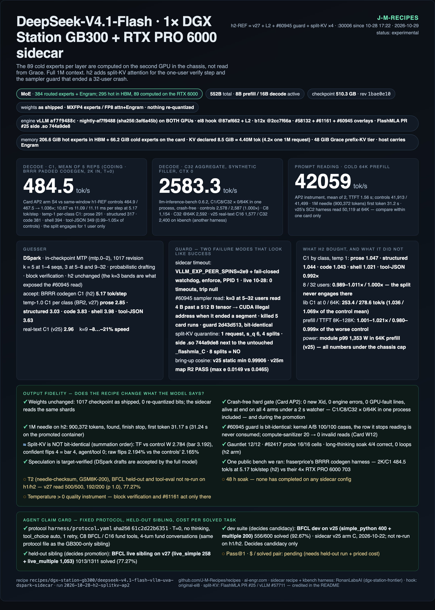

# DeepSeek-V4.1-Flash · 1M context on a DGX Station GB300 + RTX PRO 6000 sidecar

The 510 GB DeepSeek-V4.1-Flash-1017 checkpoint does not fit in one GB300. This recipe keeps the hot experts in the
GB300's HBM and moves the cold experts to the **RTX PRO 6000 Max-Q in the same box, which computes them**. Only
activations cross PCIe. The [GB300-only sibling recipe](../deepseek-v4.1-flash-vllm-uva-dspark/README.md) takes the
other road: it reads cold experts from Grace memory, which puts a serial read on every decode step.

## Status



- **Serving:** Pg61 on `:30006` of the reference box, since 2026-10-29 10:14pm CDT. Pg61 is
  [Garner McCloud's DS4.1 engine](https://github.com/garnermccloud/dgx-station-recipes/tree/8043a6811a5feda70fdfb6e827eebb2ec25c65d1/deepseek-v4.1-flash)
  run under our policy and patch set.
- **Status:** `experimental`. Pg61 is **still being tested**.
- **Soak:** 48 h, ending **Saturday 2026-10-31 10:14pm CDT**. Any restore or card restarts the clock.
- **Rollback:** h2-REF, one command: `bash scripts/rollback-pg61-to-h2ref.sh`. The script is dry-run tested only
  (see [Rollback](#rollback)).
- **Bundle:** [`results/2026-10-29-pg61-garner-engine/`](results/2026-10-29-pg61-garner-engine/README.md).
- **Related:** blogs
  [GB300 + sidecar vs 4× RTX PRO 6000 (BRRR)](https://al-engr.com/gb300-vs-4x-rtx6000-dsv41-flash-brrr.html),
  [Adaptive Residency Part 3, the seed map](https://al-engr.com/gb300-adaptive-residency-seed-map.html) and
  [Part 1, with its convergence correction](https://al-engr.com/gb300-adaptive-expert-residency.html). Peer recipe:
  [fraserprice/DeepSeek-4.1-Flash-1017-BRRR](https://huggingface.co/fraserprice/DeepSeek-4.1-Flash-1017-BRRR).
- **How we got here:** one line per round in [History](#history).

## At a glance

### Headline (Card G5): Pg61 vs h2-REF, per-class C1, temperature 1.0, mean of 3 seeds

| class | Pg61 tok/s (3 seeds) | h2-REF tok/s (3 seeds) | **Pg61 / h2-REF** | acceptance_len Pg61 / h2-REF |
|---|--:|--:|--:|---|
| prose | 367.2 (356–377) | 289.7 (283–296) | **1.27×** | 3.02 / 2.96 |
| structured | 396.9 (393–404) | 314.0 (311–316) | **1.26×** | 3.27 / 3.21 |
| code | 494.9 (480–504) | 368.8 (357–386) | **1.34×** | 4.30 / 3.82 |
| shell_ops | 530.4 (525–536) | 388.9 (386–393) | **1.36×** | 4.65 / 4.03 |
| tool_json | 463.8 (456–471) | 356.5 (349–369) | **1.30×** | 3.97 / 3.68 |
| **mean** | | | **1.31×** | |

These are 40 private Hermes-transcript prompts per class, 256 forced tokens, `--temperature 1.0 --top-p 1.0`, seeds
42/43/44, one boot per arm in the same window, with 0 errors and 0 foreign tokens. acceptance_len = 1 + accepted per
draft step. Most of the gain is step time, not acceptance: acceptance_len rises 2–15 % by class while tok/s rises
26–36 %.

### What a caller sees (live lane, 2026-10-30)

Measured on the serving Pg61 lane 2026-10-30 7:02–7:12am CDT from a LAN client during the soak (light load, the lane
stayed up): chat completions, streaming, thinking on the server's default budget, temperature 0. Instrument and raw
JSON: [`results/2026-10-29-pg61-garner-engine/caller-2026-10-30/`](results/2026-10-29-pg61-garner-engine/caller-2026-10-30/).

| measure | Pg61 | h2-REF, 2026-10-28 (closed PR #100) |
|---|---:|---:|
| single stream, 400-token reply | **343 tok/s** (median of 3; 303 / 343 / 346) | 258 tok/s |
| 40-token turn, complete | **91 ms** (median of 5) | 162 ms |
| 8 concurrent streams × 400 tokens | **1,088 tok/s** aggregate (median of 3; 858 / 1,088 / 1,107) | 926 (900–943) |
| first token, idle | 35 ms | 36 ms |
| quiet single-stream step (median inter-chunk gap) | 7.5 ms | ~14 ms |
| worst-10 % gap while a 33K prompt is read | **132 ms** (median of 3; 131–135; max 623 ms once) | 155 ms |
| that 33K prompt's first token | 0.87 s (median of 3; 0.9 / 0.9 / 1.4) | 0.57 s |

The h2-REF column is a different, ad-hoc script on 2026-10-28: context, not a paired ratio (re-running h2-REF
would end the soak). A chunk is one engine step. The 33K row counts only gaps while the long prompt is read; outside
that window the stream's p90 is 8.5 ms. The slower 33K first token matches Pg61's prefill cost (see Known limits).

### T3 promotion bench (Card G4): Pg61 vs h2-REF, same window

| bar | Pg61 | h2-REF | verdict |
|---|---|---|---|
| launcher reproduces G3 | `docker inspect` Args identical, hashes OK, 24 ACTIVE | — | PASS |
| needle-checksum 500 | EXACT 500/500 | EXACT 500/500 | PASS |
| GSM8K-1319 | 96.97 % (1279); vs v25m p = 0.73 | 96.89 % (1278); paired p = 1.0 | PASS |
| MMLU-Pro-1000 | **87.7 %** | 85.3 %; paired 10 lost / 34 gained, p < 0.001 | PASS (better) |
| T1 C1 @ 0 / 32K / 128K | 324.7 / 322.1 / 320.5 | 247.3 / 266.4 / 250.4 | 1.31× / 1.21× / 1.28× |
| T1 C4 @ 0 / 32K / 128K | 773.7 / 757.4 / 803.8 | 689.7 / 678.8 / 678.5 | 1.12× / 1.12× / 1.18× |
| T1 C8 (no bar) | 1,288 / 1,259 / 1,262 | 1,124 / 1,127 / 1,124 | 1.12–1.15× |
| watchdog / survival | 0 trips, server up | — | PASS |
| tool-eval ×2 (no bar) | 89 · 91 | 89 · 93 | same band |

T1 is llm-inference-bench 0.7.7 synthetic filler at the server's default temperature, C ≤ 8 from the M4.
[PREREG](results/2026-10-29-pg61-garner-engine/cards/G4/PREREG.md).

### GB300 only vs GB300 + sidecar (measured 2026-10-22 on the v25 base launch)

This table is **not Pg61**. It was measured on 2026-10-22 on the v25 base launch: same box, same checkpoint, same
harness, bracketed controls in one window. It is still the reason this recipe exists.

| | GB300 only (sibling recipe, v23) | GB300 + RTX 6000 sidecar (this recipe) |
|---|--:|--:|
| Decode C1, real text 8.2K/1,024 | 187.5 tok/s | **279.5 tok/s** (+49%) |
| Decode C16 | 524.5 | **1,576.9** (3.0×) |
| Decode C32 | 936.9 (max-num-seqs 24, queues) | **2,400.3** (2.6×) |
| TTFT, 8.2K prompt | 0.66 s | **0.19 s** |
| Cold 64K prefill | 23,439 tok/s | **50,119 tok/s** |
| 1M-token prompt, first token | 81.4 s (12,262 tok/s) | **33.2 s** (30,069 tok/s) |
| KV pool at 1M ctx | 2,504,891 tokens (util 0.97) | **4,400,013 tokens** (`--kv-cache-memory` 8.5 GiB; 2,537,081 at util 0.97) |
| Host memory pinned | ~253 GiB (Engram + cold experts) | Engram only — cold experts are on the card |
| Extra process you must keep alive | — | one sidecar container + a fail-closed watchdog |
| Wins on | simplicity, no second GPU, prefill is throttled the same | decode at every concurrency, TTFT, long-context reads |

Both recipes serve the same weights and stay published. This one is the faster lane on this hardware; the sibling
is the one that needs nothing but the GB300.

## What this runs

**Pg61, serving since 2026-10-29 10:14pm CDT.** DeepSeek-V4.1-Flash-1017 (MXFP4 routed experts, FP8
attention/Engram, in-checkpoint DSpark drafter) at the full **1,048,576-token** context. Both GPUs run the stock,
pullable `vllm/vllm-openai:v0.31.0` (`sha256:c1c9f6fd…`).

### Garner's engine

The engine and the speed are Garner McCloud's:
[`garnermccloud/dgx-station-recipes`](https://github.com/garnermccloud/dgx-station-recipes) @ `8043a681`
(`deepseek-v4.1-flash/`, MIT), launched by his `serve/serve.sh` and built on original-el8's hook. His release, as
shipped, reproduces on our RTX PRO 6000 **Max-Q (300 W)**: 135.9 steps/s against his published 135.4 (Card G0).

* **GB300.** Container `ds41`: `vllm serve`, TP1, `--moe-backend deep_gemm_mega_moe`, `fp8_ds_mla` KV, 32 seats,
  util 0.95, a 48 GB host KV tier, **255 hot experts per layer** (`rowmap-mix-v1-h255.json`). KV pool:
  **11,696,582 tokens** at 1M (11.15× one 1M request; h2-REF: 4,400,013).
* **RTX PRO 6000 Max-Q.** Container `ds41-sidecar` holds the other **129 experts per layer** (98.5 GB allocated).
  It serves **peer tier v3** (SM120 block-scaled QMMA) for steps of ≤ 64 tokens, and peer tier v2/b12x above that.
* **His speed layer.** 24 of the 29 `DS41_FASTPATH` components (fused drafter tails, decode-attention and
  pre-attention paths, copy/suffix drafting, `topp_fast`, Engram side-streams, fast load, cold-skip and more), his
  DeepGEMM MegaMoE scheduling fork, his FlashInfer tune file and his #58132 / 1017 overlays.
* **Drafting.** DSpark k = 5/3/3 by batch size (`[[1,4,5],[5,8,3],[9,32,3]]`), probabilistic drafting, block
  verification. Unchanged from his release and from h2-REF.

### Ours on top

| piece | what | file |
|---|---|---|
| policy hooks (patches 01–02) | six hooks in his `serve.sh` / `recipe.env`, each a no-op unless set: no API key, no `--attention-config`, no `--override-generation-config`, no reasoning-effort default, a component-list override, `PEER3_SPINS` forwarded | [`patches/garner-8043a681/`](patches/garner-8043a681/README.md) |
| #61161 port (patches 03–05) | `seed ^ (step << 32)` in his three fused draft samplers (`w5_markov.py`, `w5_markov_gemv.py`, `w6mk.cu` → rebuilt `libw6mk.so`) | same |
| vLLM overlay (2 files) | `gumbel.py` (#61161) and `rejection_sampler_utils.py` (#61161 + **#60945 guard**), byte-identical to what h2-REF mounts, built from [`patches/vllm-61161-…`](patches/vllm-61161-block-verification-fresh-draws.patch) + [`patches/vllm-60945-…`](patches/vllm-60945-rejection-sampler-guard.patch) | same, README |
| fail-closed watchdog | [`scripts/sidecar_watchdog_p3.py`](scripts/sidecar_watchdog_p3.py) (v2 + peer tier v3); refuses to arm unless the server runs `PEER3_SPINS` ≥ 1e12 | Card G3-desk / G3 |
| launcher, cutover, rollback, lane check | [`scripts/launch-pg61.sh`](scripts/launch-pg61.sh), [`cutover-h2ref-to-pg61.sh`](scripts/cutover-h2ref-to-pg61.sh), [`rollback-pg61-to-h2ref.sh`](scripts/rollback-pg61-to-h2ref.sh), [`pg61_lane_check.sh`](scripts/pg61_lane_check.sh) | — |

### Why each patch exists

- **The #60945 guard.** Stock v0.31.0 lacks it. The block-verification kernel reads one `int32` past `draft_sampled`,
  and Card G1 died with `CUDA error: an illegal memory access` on a 32-request × 4-token step. The 3-line guard alone
  made that config survive 3 × 60 s C32 (G1f). Reported to Garner as
  [issue #1](https://github.com/garnermccloud/dgx-station-recipes/issues/1).
- **The #61161 port.** v0.31.0 and his fused drafters reuse a just-rejected draw when they re-draft, which biases
  every temperature > 0 sample. The port equals production's eager reference at every step and costs no C1
  (Pg61/Pg = 1.012, G5).
- **`PEER3_SPINS=1e12` + `sidecar_watchdog_p3.py`.** A peer tier v3 timeout silently skips the cold-expert add and
  streams wrong tokens. Infinite spins turn that into a hang; the watchdog turns the hang into a fail-stop (~3 s in
  Card G3b).

Full reasoning, Cards G0 → G5 and the cutover log:
[HISTORY.md, 2026-10-29](HISTORY.md#2026-10-29-pg61--garners-ds41-engine-under-our-policy-promoted-soak-in-progress).

### Left out on purpose (policy)

- **Weights and KV.** Stock weights only. KV is `fp8_ds_mla`; his release uses `nvfp4_ds_mla`, and KV quantization is
  ruled out here because it changes numerics. The indexer is the default (his: MXFP4 indexer K + sparse logits).
- **Context and memory.** `--max-model-len 1048576` (his: 524,288), a 48 GB host KV tier, util 0.95.
- **Requests.** No forced T = 1.0 / top_p 0.95, no reasoning-effort default, no API key.
- **Components.** 24 of his 29. `ds41_sampling` and `ds41_stop` are dropped as sampling policy. `w8oproj`, `lowb_aux`
  and `tail_drafthead_mxfp8` are dropped because each changes numerics by design (the last is also a requantized
  draft-head copy).

### The correctness trap

If the sidecar is late, the GB300 does not raise an error. It **skips that layer's cold-expert add and keeps
emitting tokens**, and those tokens are wrong. Effectively infinite spins make a dead sidecar hang the lane instead,
and a watchdog in enforce mode kills a hung lane. Pg61 uses `PEER3_SPINS=1000000000000` and the p3 watchdog; the
rollback lane uses `VLLM_EXP_PEER_SPINS=2e9` and `scripts/sidecar_watchdog.py`.

### The rollback lane (h2-REF)

h2-REF served 2026-10-28 5:22pm → 2026-10-29 10:07pm CDT and is now stopped and kept. It is the RonanLabsAI-shaped
launch on nightly af7f9488: el8's hook on the GB300 (295 hot / 89 cold experts per layer), el8's peer tier-2 server
with b12x on the RTX, the 48 GiB Grace prefix-KV tier, block verification, L2 key-sharing, #61161, the #60945 guard
and one-request split-KV ([details](HISTORY.md#what-h2-ref-and-earlier-releases-run)).

Why a sidecar beats Grace offload: the cold-expert work stops being a serial C2C read and becomes a parallel GEMM on
a second GPU. Step time on this chassis falls from ~14.6 ms (Grace offload, C1) to ~10.6 ms, and the 1M first token
drops from 81 s to 33 s.
## Hardware

One NVIDIA DGX Station GB300 with an RTX PRO 6000 Blackwell Max-Q add-in card. Profile:
[`hardware/dgx-station-gb300-rtx6000.yaml`](../../../hardware/dgx-station-gb300-rtx6000.yaml).

| | value |
|---|---|
| Compute GPU | GB300, **250.7 GiB** visible / 249.8 GiB CUDA-allocatable (not the 288 GB spec), 1,300 W cap |
| Sidecar GPU | RTX PRO 6000 Blackwell Max-Q, **95.6 GiB**, 300 W cap (325 W max), 96 GB class |
| GPU↔GPU | PCIe via the Grace root complex; **P2P unsupported** (`topo -p2p r` = NS) — hence `/dev/shm` |
| Host | 494.5 GiB LPDDR5X, Grace 72× Neoverse-V2, NVLink-C2C |
| Driver / CUDA | 595.91.07 / 13.2 (container runtime 13.0.2) |
| OS / kernel | Ubuntu 24.04.5 LTS / 7.0.0-1019-nvidia-64k |
| Power | 1,600 W Station budget shared by both GPUs, `vsloshd` inactive |

Two settings that are not optional:

1. **CDI for the RTX card.** DGX OS's `/usr/libexec/dgx-desktop-docker-gpus.sh` hides the VGA-class card from
   `--gpus`. Generate a CDI spec (`nvidia-ctk cdi generate --output=/etc/cdi/nvidia.yaml`) and pin by UUID
   (`--device nvidia.com/gpu=<RTX UUID>`). The launcher refuses to start the sidecar on a card already holding
   ≥2,048 MiB, because that card also drives the display/JetKVM.
2. **Local NVMe for the checkpoint**, and persistent JIT caches (vLLM, FlashInfer, DeepGEMM, tilelang, triton,
   b12x). The sidecar reads expert tensors out of the shards layer by layer at prep time.

## Software

**Pg61 (serving since 2026-10-29 10:14pm CDT):**

| piece | pin |
|---|---|
| image (both GPUs) | `vllm/vllm-openai:v0.31.0` = `sha256:c1c9f6fd5c109ba7f0546a59f5b2f15fb87f64c77782e90a27b648b42a8e67c3` (a pullable release; repo digest = image id on the box; `VLLM_BUILD_COMMIT` db9527a4). [`results/2026-10-29-pg61-garner-engine/image.txt`](results/2026-10-29-pg61-garner-engine/image.txt) |
| engine | **Garner McCloud**, [`garnermccloud/dgx-station-recipes`](https://github.com/garnermccloud/dgx-station-recipes/tree/8043a6811a5feda70fdfb6e827eebb2ec25c65d1/deepseek-v4.1-flash) @ `8043a6811a5feda70fdfb6e827eebb2ec25c65d1`, `deepseek-v4.1-flash/` (MIT). Not vendored; `launch-pg61.sh build` refuses any other HEAD |
| our patches on his tree | [`patches/garner-8043a681/01…05`](patches/garner-8043a681/README.md) → `serve/serve.sh` 212d2a03, `config/recipe.env` 71d39119, `fastpath/w5_markov.py` 62357c0b, `fastpath/w5_markov_gemv.py` ede5fd52, `kernels/w6-moe/markov/w6mk.cu` a17b2ba2 (sha1; equal to the serving build tree) |
| `libw6mk.so` | rebuilt by `build` (`nvcc -gencode=arch=compute_103a,code=sm_103a` inside the image) → sha256 `b54168223847560b…` in the serving container |
| vLLM overlay | his `docker/overlay-58132/vllm` + `gumbel.py` (sha1 6eac3e13 = sha256 ee5072d2) and `spec_decode/rejection_sampler_utils.py` (sha1 edc8f8f4 = sha256 2d43d513), the same bytes h2-REF mounts, built from the #61161 and #60945 patches below ([desk check](results/2026-10-29-pg61-garner-engine/overlay-desk-check.txt)) |
| watchdog | [`scripts/sidecar_watchdog_p3.py`](scripts/sidecar_watchdog_p3.py) (box sha1 812c47c0; the published copy differs only in its default log paths) |

**h2-REF (the rollback lane) and earlier releases** pin nightly af7f9488
(`vllm/vllm-openai@sha256:3af6a45b…`), original-el8's hook @87af662, b12x and the h1/h2 patches. That table and the
in-container hash receipts are in
[HISTORY.md → Software pins for h2-REF and earlier releases](HISTORY.md#software-pins-for-h2-ref-and-earlier-releases).

Checkpoint identity (revision, 49 shards, 510,311,114,235 B, config/index hashes) is in
[`raw/weights-1017-receipt.txt`](results/2026-10-22-v25-sidecar/raw/weights-1017-receipt.txt).

## Launch

**The serving config, Pg61.** You need Garner's checkout at the pin, the overlay files built from this recipe's
patches (once, see [`patches/garner-8043a681/README.md`](patches/garner-8043a681/README.md)), the 1017 checkpoint on
local NVMe and the CDI spec for the RTX (see Hardware). Then:

```bash
git clone https://github.com/garnermccloud/dgx-station-recipes.git ~/dsv41/garner/src
git -C ~/dsv41/garner/src checkout 8043a6811a5feda70fdfb6e827eebb2ec25c65d1
# 1. build (CPU only): copy his deepseek-v4.1-flash/, apply patches 01-05, rebuild libw6mk.so (sm_103a) in the
#    image, layer overlay-vllm over his overlay-58132, write policy.env and BUILD-SHA256SUMS
GARNER_SRC=~/dsv41/garner/src WORK=~/dsv41/garner/pg61-work bash scripts/launch-pg61.sh build
# 2. up: his serve.sh start with policy.env (sidecar first, then server), wait for /v1/models, check the in-container
#    hashes + PEER3_SPINS, run the watchdog --once, then arm it in ENFORCE (setsid nohup, PPID 1)
WORK=~/dsv41/garner/pg61-work MODEL_DIR=/models/DeepSeek-V4.1-Flash-1017-<rev> DS41_HOME=~/dsv41/garner/home \
  bash scripts/launch-pg61.sh up
WORK=~/dsv41/garner/pg61-work bash scripts/launch-pg61.sh render   # print the policy env + the serve.sh call
WORK=~/dsv41/garner/pg61-work DS41_HOME=~/dsv41/garner/home bash scripts/launch-pg61.sh down
```

`policy.env` is the whole policy. It sets `DS41_PORT=30006`, `DS41_SERVED=dsv41-flash-uva`,
`DS41_ALIASES=deepseek-v4.1-flash`, `DS41_GPU_MODE=cdi`, `DS41_NO_KEY=1`, `DS41_MAXLEN=1048576`,
`DS41_KV=fp8_ds_mla`, `DS41_OFFLOAD_GB=48`, `DS41_EFFORT_DEFAULT=0`, the 24-component
`DS41_FASTPATH_COMPONENTS_OVERRIDE`, `DS41_OVERLAY_58132_DIR=$WORK/overlay-vllm` and
`DS41_PEER3_SPINS=1000000000000`.

In Card G4 the launcher-booted container's `docker inspect` Args equalled the G3 container's element for element
([`args-diff.txt`](results/2026-10-29-pg61-garner-engine/raw/G4/box/Pg61/args-diff.txt)). Container names are his
(`ds41`, `ds41-sidecar`). The published launcher differs from the box copy in two defaults only (`PATCHES`,
`WATCHDOG`). The h2-REF → Pg61 move is [`scripts/cutover-h2ref-to-pg61.sh`](scripts/cutover-h2ref-to-pg61.sh)
(`--dry-run` checks preconditions only); it falls back to the rollback script on any failure after the stop.

**h2-REF and earlier releases** (`scripts/start-h2ref.sh`, `scripts/launch-sidecar.sh`, the bring-up cosine gate and
the v2 watchdog) are in [HISTORY.md → Launching h2-REF and earlier releases](HISTORY.md#launching-h2-ref-and-earlier-releases).

## Verify

| gate | how | bar |
|---|---|---|
| **Pg61 launcher verify** | `WORK=… bash scripts/launch-pg61.sh verify` reads, inside `ds41`: `sample/gumbel.py` sha1, `spec_decode/rejection_sampler_utils.py` sha1, `/fastpath/libw6mk.so` sha256 and `PEER3_SPINS` | gumbel `6eac3e13…`, rsu `edc8f8f4…` (the #60945 guard), libw6mk equal to the build tree's, `PEER3_SPINS=1000000000000`. Passed at the cutover (10:14:12pm CDT) and in Cards G4 and G5 |
| **Pg61 p3 watchdog** | `$WORK/wdp3.status.json` and `$WORK/wdp3.log`; one `sidecar_watchdog_p3.py --mode enforce` process (PPID 1) | `"mode": "enforce"`, `"trip": null`, `server_up: true`, v2 `[pub, done, 0]` with pub = done, v3 `[2, tag, tag, 0]`, status age < 60 s, no `TRIP` line. It refuses to arm (exit 3) without `PEER3_SPINS` ≥ 1e12 |
| **Pg61 lane check** | [`scripts/pg61_lane_check.sh`](scripts/pg61_lane_check.sh) (`GB300_SSH=user@host`; an M4 cron every 10 min) | silent when `UP` is exactly `ds41 ds41-sidecar`, `BOUND=1`, the p3 watchdog is alive, `trip None`, status age < 60 s, `BUILD-SHA256SUMS -c` OK and no TRIP lines. Anything else prints and names the rollback |
| Pg61 boot facts | server log | 24 components ACTIVE, 0 fallback lines, `GPU KV cache size: 11,696,582 tokens … 11.15x`; sidecar `prepared 40 layers` + `serving` |
| bring-up numerics | `scripts/gate_cosine.py` on a check-mode boot | 40/40 layers, ≥32 rows, min cos ≥ 0.999, 0 timeouts — measured **0.99906** (v25 static map; not run on Pg61's peer tier v3, see Known limits) |
| lane health (h2-REF and earlier) | both containers up, `/v1/models`, watchdog `trip=null`, `words[2]=0`, boot KV line 4,400,013 tokens | `scripts/soak_check.sh` prints `OK` |
| KV capacity | four ~1M contexts resident at once, 16K tokens decoded each (`results/2026-10-22-kv85/scripts/kv2_coresident.py`) | 4 running / 0 waiting, 0 preemptions, 0 errors, 0 trips, 0 timeouts — measured KV peak **75.3%** |
| output quality | teacher-forced flips vs a same-map floor, BFCL dev+held-out, GSM8K-1319, 500-needle, gauntlet, reasoning-effort vocabulary, one image request | SC2's 12 pre-registered gates |
| drafter | per-class decode wall-clock, 20 cells × {C1, C8} | no cell worse than −3% vs both controls |
| speed | bracketed ladders with a control on each side | knee C1 ≥ 198, knee C16 ≥ 974, sidecar C16 ≥ Grace-only +3% |
| soak | 48 h, sampled every 5 min — restarted with the KV change: 2026-10-22 18:52 → 2026-10-24 18:52 CDT. *(Corrected 2026-10-26: that window was cut at ~25 h and the v25m window was cancelled; no 48 h soak has completed on any sidecar config, v27 included.)* **Pg61: running 2026-10-29 10:14pm → 2026-10-31 10:14pm CDT, sampled by `scripts/pg61_lane_check.sh` every 10 min.** | no timeout, no trip, no stall; lane check silent throughout |
| **h2-REF serving release** | in-container sha256: `rejection_sampler_utils.py` **2d43d513** (guard; 42c5e8a0 = unguarded), `_flashmla_splitkv_C.abi3.so` 744a9de8 mapped by the engine, `_flashmla_C.abi3.so` df2cdd1c untouched. Log: split-KV `ENABLED cap=4 max_reqs=1`, the only decode gate line `s_q=6 splits=4 … op=_flashmla_splitkv_C`, `TRACE ok=1` only at (6, 6, 1 decode, 0 prefills), 0 GUARD lines, 2 `MEGA_L2` patched lines, `Loaded 117 configs`. KV 4,400,013; `journalctl -k` shows no new Xid since boot; watchdog enforce, PPID 1 | all checked at promotion ([`promote/promote.log`](results/2026-10-28-h2-splitkv-ap2/promote/promote.log)) and re-read at 22:53Z |
| crash-free (any lane change) | the C32 lib cells in one process (C1/C8/C32 × 0/64K) under a 2 s Xid/fault watcher | 0 new Xid, 0 engine errors, 0 GPU-fault lines, alive at end — Card AP2 all four arms |
| kv-host-tier (variant) | boot log `Creating v1 connector with name: OffloadingConnector` + `Created mmap file /dev/shm/vllm_offload_….mmap (51.54 GB)`, GPU KV line still 4,400,013; evict-replay probe in `results/2026-10-24-kv3-host-prefix-tier/scripts/kv3_cells.py` (needs dev mode, test boots only) | host-tier hit + load, identical output; Card KV3's 10 gates |

Nothing here is promoted on throughput alone: the cosine gate and the 0-timeout soak are pass/fail, and a
timeout is treated as a correctness bug rather than a slow request. The v27 row is in
[HISTORY.md → Superseded Verify rows](HISTORY.md#superseded-verify-rows).

## Results

### Pg61 = the serving config (promoted 2026-10-29 10:14pm CDT, soak in progress, `results/2026-10-29-pg61-garner-engine/`)

Bundle: [`results/2026-10-29-pg61-garner-engine/`](results/2026-10-29-pg61-garner-engine/README.md). It holds
`throughput.csv` (every `bench_full`, prefill, T1 and per-class cell × arm × card), the card write-ups and
pre-registrations for G0–G5, raw receipts per card (per-class rows withheld), the desk checks and the cutover log.

- **Speed:** **1.31× h2-REF** per-class C1 (T = 1, 3 seeds); T3 all six bars PASS. Tables: [At a glance](#at-a-glance).
- **Quality on Pg (Card G2):** needle 500/500; GSM8K-200 193/200, p = 1.0; tool-eval 91/100; BFCL held-out 78.26 %
  vs v27 77.27 %, p = 0.011. On Pg61 (Card G3): GSM8K-200 192/200, BFCL held-out 1026/1311 = 78.26 %.
- **Cost:** prefill is −8 to −10 % (his bench) to −17 % (T1 scouts) against h2-REF.

### Releases

| release | served on `:30006` | bundle | result |
|---|---|---|---|
| **Pg61** | 2026-10-29 10:14pm CDT → now (soak) | [`2026-10-29-pg61-garner-engine`](results/2026-10-29-pg61-garner-engine/README.md) | 1.31× h2-REF per-class C1 at T = 1; T3 all six bars PASS; prefill −8 to −17 % |
| h2-REF (rollback) | 2026-10-28 5:22pm → 2026-10-29 10:07pm CDT | [`2026-10-28-h2-splitkv-ap2`](results/2026-10-28-h2-splitkv-ap2/README.md) | Card AP2 S4 = PROMOTE-READY: coding C1 484.5 vs 467.5 tok/s (1.036×), crash-free on all four arms |
| h1-REF | 2026-10-27 4:46pm → 2026-10-28 5:13pm CDT (with the #60945 guard from 2:42pm) | [`h1-lineage`](results/2026-10-28-h2-splitkv-ap2/h1-lineage/) | Card H1: −0.117 ms/step, bit-identical; `SUBBAR` against its bar, promoted by James |
| v27 | 2026-10-26 4:08am → 2026-10-27 4:46pm CDT | [`2026-10-26-br1-block-verification`](results/2026-10-26-br1-block-verification/), [`2026-10-26-v27-t2-heldout`](results/2026-10-26-v27-t2-heldout/README.md) | Card BR1 block verification PASS (re-scored): +2.0 % tokens/step; T2 and held-out BFCL 77.27 % PASS |
| v25m-kvtier | 2026-10-24 11:16pm → 2026-10-26 3:58am CDT | [`2026-10-24-kv3-host-prefix-tier`](results/2026-10-24-kv3-host-prefix-tier/) | v25m map + 48 GiB Grace prefix-KV tier; Card KV3 10/10 gates, no measurable speed cost |
| v25m (variant) | soaked from 2026-10-24 7:12am until James cancelled the soak that day | [`2026-10-23-ar5-mixed-map`](results/2026-10-23-ar5-mixed-map/), [`2026-10-24-gv-v25m-gates`](results/2026-10-24-gv-v25m-gates/) | mixed-traffic map: held-out mixed C1 +5.8 %; Card GV 9 of 10 gates (cosine miss 0.99811) |
| v25, KV declared 8.5 GiB | from 2026-10-22 evening | [`2026-10-22-kv85`](results/2026-10-22-kv85/) | KV 2,537,081 → 4,400,013 tokens (+73%) at the same speed |
| v25 (first sidecar launch) | 2026-10-22 | [`2026-10-22-v25-sidecar`](results/2026-10-22-v25-sidecar/) | C1 279.5 vs 187.5 (+49%), C16 3.0×, 1M first token 33.2 s; SC2 all 12 gates PASS |

Cards that did not change the release:

| card | bundle | result |
|---|---|---|
| BR2: k ladder + BRRR peer harness | [`2026-10-26-br2-k-ladder-peerbench`](results/2026-10-26-br2-k-ladder-peerbench/) | k=9 reads 0.79–0.92× at C1; k=5 stays. Peer harness: 2K/C1 466 tok/s TG p50, 64K prefill 46,246 tok/s |
| GV2: layer 39 on the static split | [`2026-10-24-gv2-l39-static`](results/2026-10-24-gv2-l39-static/) | did not fix the cosine miss (min 0.99831) |
| Cosine gate R2 re-judge | [`2026-10-26-gs-cosine-r2`](results/2026-10-26-gs-cosine-r2/README.md) | R2 PASS for the v25m map (max e 0.01487 vs bar 0.04646) |

The long write-up for each release is in [HISTORY.md → Superseded Results subsections](HISTORY.md#superseded-results-subsections).

## Known limits

**Pg61 (the serving config since 2026-10-29):**

* **Still being tested.** The 48 h soak runs to Saturday 2026-10-31 10:14pm CDT, and the recipe stays
  `experimental`. Any restore or card restarts the clock.
* **`PEER3_SPINS=1000000000000` is required.** On a peer tier v3 wait timeout (his default: 20,000,000 polls), all
  three v3 wait sites (peer3 `finish_kernel`, the boundary fold, the MegaMoE fork's W6 fold) skip the cold-expert adds
  and stream wrong tokens; the count lives only in GB300 device memory. Write the spins as plain digits:
  `fastpath_peer3` parses them with `int()`, and `1e12` would crash the boot. **The watchdog refuses to arm (exit 3)
  without it.** Do not serve his engine with the default spins. (Peer tier v2 traps on a timeout and fails loud.)
* **Clients killed by a trip see no `finish_reason`.** In G3b the streams simply ended, with no `finish_reason` and
  no HTTP error, because the server was killed mid-stream. Callers must treat a missing `finish_reason` as a failure,
  not as a short answer.
* **The final watchdog file has not fired under fault injection.** The G3b trip ran the version from before a
  log-ordering fix (log the server kill, unpause, then stop the sidecar). The fixed file passes 13/13 unit tests and
  ran armed through G4, G5 and the cutover with 0 trips.
* **MMLU-Pro +2.4 pt is unexplained.** In T3 Pg61 read 87.7 % against h2-REF's 85.3 % (paired 10 lost / 34 gained,
  p < 0.001). It is not answer length: median completions were 313 vs 310 tokens, and neither container sets a
  reasoning-effort default. Runaways to the 131K cap (14 vs 20) explain at most 6 of the net +24 items. The cause was
  not investigated. Read it as "no loss", not as a quality gain we understand.
* **Tool-eval moves ±2 run to run at T=0 / C4.** In T3, Pg61 read 89 and 91 and h2-REF 89 and 93; in G2/G3, Pg read
  91 and Pg61 89. One run cannot rank two configs.
* **Prefill is slower than h2-REF.** His bench reads −8 to −10 % at 14K–114K (e.g. 114K: 41.0K vs 44.6K tok/s), and
  the T1 scouts (N = 1) read −10 to −17 % at 8K–128K (128K: 39,775 vs 48,062 tok/s). The 1M first token is 36.5 s
  (999,034 tokens, 27.3K tok/s, measured on Pg in G1f) vs the v25 launch's 33.2 s; h2-REF's own 900K needle was
  31.17 s. The probable cause, not measured, is 129 cold experts per layer on the RTX (h255 map, vs our 89), with
  T > 64 on peer tier v2. A rowmap sweep (h270/h285 under our policy) is planned after promotion; it costs KV tokens.
* **Not exercised:** a temperature > 0 quality score (every quality gate is T = 0 or teacher-forced; the #61161 port
  is kernel-exact in G3 and costs no C1 in G5), and decode beyond 128K except one 1M needle on Pg (G1f, before the port).
* **No per-layer cosine bring-up gate on peer tier v3.** `gate_cosine.py` was not run on Pg61. The end-to-end
  evidence that the sidecar path is numerically right is the TF check against h2-REF at the control floor (Pg,
  G1f), plus the T2/T3 gates.
* **The launcher-built `libw6mk.so` (sha256 `b5416822…`) is not byte-identical to the hand build G3 tested
  (`b072ee09…`)** — nvcc embeds build paths. Its device code is identical (both sm_103a cubins match,
  `results/2026-10-29-pg61-garner-engine/libw6mk-cubin-identity.txt`). G4 and G5 measured the `b5416822` build.
* **Garner's engine is not ours to support.** His tree is pinned at `8043a681`, and a newer commit is a new card. Our
  patches touch only the five files listed in `patches/garner-8043a681/`.

**Platform (every lane on this box).** Short form; the full text of these and the rollback-lane limits is in
[HISTORY.md → Rollback-lane and platform limits, full text](HISTORY.md#rollback-lane-and-platform-limits-full-text).

* **No 48 h soak has completed on any sidecar config.** The 2026-10-22 window was cut at ~25 h, and James cancelled
  the v25m window on 2026-10-24. Pg61's soak is running.
* **A silent sidecar timeout is wrong output.** Infinite-spin + watchdog, or do not serve. Do not run the lane
  in `--mode report` and call it production.
* **The power cap binds in prefill**, on the GB300-only incumbent too. Every number here was measured under that
  throttling; a 240 V / uncapped retest is the obvious next measurement.
* **A cold 1M prefill stalls everything behind it** (v25: a 131K neighbour waited 34 s for its first token; C16
  aggregate 1,576 → 718 tok/s). Keep long batch jobs off the interactive lane, or accept the stall.
* **k > 5 is a loss on real traffic with this drafter** (Card BR2: k=9 reads 0.81–0.92× at C1 per class, 0.79× on
  mixed traffic). The checkpoint's `dspark_block_size` is 5.
* **Block verification is lane-specific:** it needs probabilistic drafting. The Grace-only sibling retired it. Do
  not copy this key to another lane without its own bracket.
* **KV routes not taken:** KV quantization (`nvfp4_ds_mla`) changes numerics; more cold experts on the card is
  modeled at −5 to −11% C1; HiSparse host-resident KV is not wired for DeepSeek-V4.1 or the MegaAttn backend.

**The rollback lane (h2-REF) and older kept pairs** (short form; full text at the link above):

* **v27 and every launch before h1-REF's 2026-10-28 2:42pm restart carry an out-of-bounds read** in af7f9488's
  block-verification sampler. It is fatal at 32 requests and killed five card runs. h1-REF and h2-REF carry the
  #60945 guard. Any lane with block verification and a k-schedule shorter than `num_speculative_tokens` is exposed.
* **Split-KV is quarantined to one request at s_q = 6** (`MAX_REQS=1 SQ=6 MAX_TOKENS=8`). 8 splits was **NO**
  (1.022×, 6 confident TF flips against a bar of 4).
* **Split-KV is not bit-identical, and its TF margin is zero** (4 confident flips against a bar of 4). The kernel
  (FlashMLA PR #25) and the overlay (vLLM #57711) have had no upstream review; a rebuild may not hash to 744a9de8.
* **h1 and h2 have not re-run T2, BFCL, GSM8K or tool-eval.** The v27 numbers predate L2, #61161 and split-KV.
* **The h2 gain is single-user and class-dependent:** BRRR codegen C1 +3.6%; C8 0.99–1.01×; C32, prefill and TTFT
  unchanged.
* **Card W12's Xid 43** came from its compute-sanitizer A/B container and was excluded by design; every serving arm
  logged 0 new Xid.
* **Block verification only acts at temperature > 0.** Clients that send temperature 0 get nothing from it.
* **The v25m map missed the bring-up cosine gate** (Card GV: min cos 0.99811 vs 0.999, 1 of 1,439 checks). The R2
  re-judge passes (max e 0.01487 vs bar 0.04646), but its bar rests on 1 of 3 reference boots.
* **v27's T2 and held-out checks ran at temperature 0**, so they do not exercise block verification.
* **A k change does not force an autotune retune on af7f9488** (K9 booted as a hash hit in 529 s).
* **kv-host-tier (Card KV3):** ~31M prefix tokens in 48 GiB, on this lane only. Multi-user hit rates and C>1 with the
  tier were not measured, there was no TF/GSM8K/BFCL run on the tier arm, and host MemAvailable drops by ~48 GiB.
* **Uniform rowmap only**, unless you port el8's per-layer-plan change to `peer_server2`.
* **Effort mapping moved:** this image maps `low`→50, `high`→75 (default), `max`→100; the GB300-only lane's 0909
  image maps `low`→25, `high`→50.
* **One runaway is possible at temp 0** (GSM8K item 1304 hit the 131,072 cap once). A client `max_tokens` is the only
  real guard.
* **Live FlashInfer autotune**, no pinned tune file: a few percent of C1 varies boot to boot.
* **Replay ON vs OFF is one rep.** The lane runs ON.
* **vLLM v0.31.0 was not adopted for this launch** (knee C8 −3.8%). Pg61 is a different launch on v0.31.0, with its
  own gates.
* **KV is declared**, so vLLM does not check activation headroom at boot (1,395 MiB free at the stressed peak).
  **`EXTRA` defaults to empty:** a fresh launch without `EXTRA="--kv-cache-memory 9126805504"` silently serves
  2,537,081 tokens.
* **Boot 527 s warm**; cold JIT caches are ~30 min. **The Docker Hub tag is gone**; pull by digest.

Limits that described only superseded configs are in [HISTORY.md → Superseded limits](HISTORY.md#superseded-limits).

## Rollback

**Pg61 → h2-REF (one command, on the Station):**

```bash
bash scripts/rollback-pg61-to-h2ref.sh --dry-run   # plan + preconditions; no docker changes
bash scripts/rollback-pg61-to-h2ref.sh
```

[`scripts/rollback-pg61-to-h2ref.sh`](scripts/rollback-pg61-to-h2ref.sh) runs these steps:

1. Refuses while a card runner is live, if the h2-REF pair (`dsv41-vllm-1017-h2-REF` + `-rtx`, stopped and kept since
   the cutover) is missing, or if its watchdog argv file is missing.
2. Sets MAINTENANCE and runs `launch-pg61.sh down`, which kills the p3 watchdog, stops `ds41` / `ds41-sidecar` and
   removes the peer shm segments. Then it drops caches.
3. Starts the h2-REF RTX container, waits for a **fresh** `serving` line, then starts the server and waits for
   `/v1/models`.
4. **Re-arms the v2 fail-stop watchdog from its argv file before judging the smoke**, so a bound lane is never left
   unguarded.
5. Runs one smoke, then clears MAINTENANCE and writes an owner line. A failed smoke leaves the lane in MAINTENANCE,
   with the watchdog armed.

**Dry-run tested only:** the script has not run end to end on the box; the cutover calls its `--dry-run`. The same
restore sequence, in the card runners' own code, brought h2-REF back after G3, G3b, G4 and G5 (bound in 420–425 s,
smoke OK, watchdog armed). On a fresh box, h2-REF is `scripts/start-h2ref.sh`
([HISTORY.md](HISTORY.md#launching-h2-ref-and-earlier-releases)). **After a p3 watchdog trip,** read
`$WORK/wdp3.log`, `docker logs ds41-sidecar` and `journalctl -k | grep Xid` before any rollback; the trip leaves the
lane down on purpose.

**Rolling back further** (h2-REF → h1-REF, v27 → v25m-kvtier, and the older kept pairs) uses
[`scripts/rollback-v27.sh`](scripts/rollback-v27.sh); the steps and manual fallbacks are in
[HISTORY.md → Older rollback pairs](HISTORY.md#older-rollback-pairs). Going back to v27 or older **reintroduces the
out-of-bounds read** (see Known limits).

## Credits

This recipe is a productionised descendant of other people's recipes, and the ordering here is deliberate.

**Engines this recipe runs:**

* **[Garner McCloud](https://github.com/garnermccloud/dgx-station-recipes): the engine the serving config (Pg61)
  runs, since 2026-10-29.**
  - **Pin.** [`8043a6811a5feda70fdfb6e827eebb2ec25c65d1`](https://github.com/garnermccloud/dgx-station-recipes/tree/8043a6811a5feda70fdfb6e827eebb2ec25c65d1/deepseek-v4.1-flash),
    `deepseek-v4.1-flash/`, MIT. Not vendored here.
  - **What is his:** the `serve/serve.sh` launcher, the 29-component `DS41_FASTPATH` layer (fused drafter tails,
    decode/pre-attention paths, suffix drafting, `topp_fast`, Engram side-streams, fast load, cold-skip,
    `a12_*`), peer tier v3 (SM120 block-scaled QMMA on the RTX), the DeepGEMM MegaMoE scheduling fork, the
    `rowmap-mix-v1-h255.json` split, the FlashInfer tune file, his overlays and his `verify/bench_full.py`.
    Cards G0–G5 used that bench, and it is the instrument for every "fixed coding prompt" number here.
  - **The speed is his.** His release, as shipped, reproduces on our Max-Q card within 0.4 % of his published
    step rate (Card G0). Of its 1.43× over h2-REF, our policy keeps 1.26× steps/s (G1); the per-class C1 headline
    is 1.31×.
  - **What is ours on top:** policy hooks, the #61161 port into his fused drafters, the #60945 guard overlay, the
    p3 watchdog and `PEER3_SPINS`, the gates, and the launcher/cutover/rollback scripts
    ([`patches/garner-8043a681/`](patches/garner-8043a681/README.md)).
  - **Upstream.** We reported the #60945 crash and the missing #61161 seed mix to him in
    [issue #1](https://github.com/garnermccloud/dgx-station-recipes/issues/1) (opened by jmeadlock, with two
    follow-up comments). He was never listed here as a measured-against peer; he appears only as the engine we run.
* **[RonanLabsAI](https://github.com/RonanLabsAI/dgx-station-frontier): the sidecar recipe h2-REF (the rollback
  lane) and every release before Pg61 run.**
  The two-step `sidecar` → `server` deployment shape, the launcher we adapted line by line, the b12x peer
  tier-2 protocol in production form, the `rowmap-mix-v1` calibration and its Stage-0 variants, the
  `MEGA_PEER_CHECK` agreement gate as a bring-up requirement, the 1M long-context work, and the
  `kbench_chat_ds.py` harness every real-text number here was measured on are his (`recipes/dsv41-flash-sidecar`
  plus `results/sidecar-ab.md`, `results/long-context-1m.md`, `logs/dsv41-1017/*`, Apache-2.0). His published
  1017 sidecar cells on that harness — C1 273.6 / C4 689.1 / C16 1,545.5 / C32 2,276.6 — are the bar we
  measured our own lane against; we land within a couple of percent of them (see Results), which is the
  honest read: **the mechanism is his.** The KV round (`results/2026-10-22-kv85/`) was measured on his harness
  and his CNN/DM prompt pool too.
* **[original-el8](https://github.com/original-el8/dgx-station-gb300-research)** — the M3 hook (hot/cold split
  inside DeepGEMM MegaMoE, cold path on the FlashInfer TRT-LLM kernel), `peer_tier2`/`peer_fused2`, and the
  `rowmap-static-v1.json` map this recipe ships unmodified, @87af662, Apache-2.0. Without the hook there is no
  hot/cold split to give the second GPU. Garner's engine (Pg61) is built on the same hook lineage; his
  ACKNOWLEDGEMENTS name original-el8 as where his recipe started.
* **[b12x](https://github.com/local-inference-lab/b12x)** (Apache-2.0) — the FP4 MoE kernels the sidecar
  replays out of its 560 captured graphs.
* **vLLM** — [#58132](https://github.com/vllm-project/vllm/pull/58132) bounded decoder replay, the
  `deep_gemm_mega_moe` backend, and the UVA offloader the sibling recipe uses.

**Upstream fixes and algorithms we run:**

* **vLLM** — [#60945](https://github.com/vllm-project/vllm/pull/60945) (the out-of-bounds lookahead fix we
  backported verbatim, into h1/h2-REF and into the Pg61 overlay on v0.31.0; its compute-sanitizer report matched our
  fault byte for byte), [#61161](https://github.com/vllm-project/vllm/pull/61161) (fresh block-verification draws;
  for Pg61 we also ported its `spec_step_seed` into Garner's three fused draft samplers) and
  [#57711](https://github.com/vllm-project/vllm/pull/57711) (split-KV MegaAttn decode, closed unmerged; our overlay
  is derived from it). **vllm-project/FlashMLA** — [PR #25](https://github.com/vllm-project/FlashMLA/pull/25), the
  split-KV mega decode kernel the h2 side extension is built from. Our part: building it as a side extension under
  its own namespace, the shape guards and NaN-safe store, the quarantine, and the crash hunt that found the
  sampler read.
* **Sun, Mendlovic, Leviathan, Aharoni, Ro, Beirami, Suresh** —
  [Block Verification Accelerates Speculative Decoding](https://arxiv.org/abs/2403.10444) (ICLR 2025), the algorithm
  behind vLLM's `rejection_sample_method: block`, which Card BR1 measured.

**Measured against, not run** (peer lanes and harnesses whose numbers we quote beside ours):

* **[Fraser Price](https://huggingface.co/fraserprice/DeepSeek-4.1-Flash-1017-BRRR)** — the BRRR recipe for
  DeepSeek-V4.1-Flash-1017 on 4× RTX PRO 6000 (fused decode kernels, `decoder.cu`), its published results table, and
  `bench.py`, which our `peerbench.py` ports with his credit header (Apache-2.0). His table is the "theirs" column in
  the 2026-10-26 side-by-side ([HISTORY.md](HISTORY.md#peer-harness-side-by-side)).

**Our delta, precisely** (so nobody re-credits us with the idea): the uniform 295/89 map choice and the
measurement that 285/99 fails its pre-registered cosine bar; running the agreement gate on real prompts and
publishing the check distribution; the ack-before-bookkeeping patch to `peer_server2.py`
([`patches/peer-server2-local.patch`](patches/peer-server2-local.patch)); the fail-closed watchdog and the
fail-stop serving policy; the bracketed control→candidate→control discipline on every speed cell; and the
quality gates (teacher-forced flips, BFCL, per-class decode) applied to a sidecar lane at all. For Pg61:
the crash bisect that tied his C32 deaths to the unguarded #60945 read, the #61161 port into his fused drafters, the
finding that a peer tier v3 timeout fails open and the `PEER3_SPINS` + p3 watchdog that close it, the policy hooks,
and the G0–G5 gates. Measurements, gate design and the write-up: **J&M Recipes** (James Meadlock, Milo). Session
note: the numbers were produced with a Claude Opus 5.5 orchestrator on the research side; the recipe was written
from the receipts.

## History

One line per dated round, newest first. The full text of each is in [HISTORY.md](HISTORY.md). The anchors on each
line keep old links into this README working.

- <a id="2026-10-29-pg61--garners-ds41-engine-under-our-policy-promoted-soak-in-progress"></a><a id="what-pg61-is"></a><a id="cards-g0--g5"></a><a id="known-costs"></a><a id="not-exercised"></a><a id="promotion-2026-10-29"></a>**2026-10-29** — Pg61 (Garner's engine under our policy) promoted after Cards G0–G5: T3 all six bars PASS, 1.31× h2-REF. [Round](HISTORY.md#2026-10-29-pg61--garners-ds41-engine-under-our-policy-promoted-soak-in-progress)
- <a id="2026-10-28-h2-ref--the-60945-guard-and-split-kv-attention-card-ap2-promoted"></a><a id="why-the-guard-came-first"></a><a id="card-ap2--a--s8--s4--a2-2026-10-28-15101708-cdt"></a><a id="h2-ref-served-2026-10-28-172258-cdt--2026-10-29-1007pm-cdt-now-the-rollback-lane-results2026-10-28-h2-splitkv-ap2"></a>**2026-10-28** — h2-REF promoted on Card AP2 (S4 = PROMOTE-READY, 1.036× coding C1); the #60945 sampler read found. [Round](HISTORY.md#2026-10-28-h2-ref--the-60945-guard-and-split-kv-attention-card-ap2-promoted) · [results](HISTORY.md#h2-ref-served-2026-10-28-172258-cdt--2026-10-29-1007pm-cdt-now-the-rollback-lane-results2026-10-28-h2-splitkv-ap2)
- <a id="h1-ref-served-2026-10-27-1646--2026-10-28-1713-cdt-the-rollback-pair-until-2026-10-29-now-second-line-behind-h2-ref"></a>**2026-10-27** — h1-REF (L2 key-sharing + #61161) promoted by James on Card H1 (`SUBBAR`, bit-identical). [Results](HISTORY.md#h1-ref-served-2026-10-27-1646--2026-10-28-1713-cdt-the-rollback-pair-until-2026-10-29-now-second-line-behind-h2-ref)
- <a id="2026-10-26-evening-t2-held-out-and-cosine-r2-on-v27"></a>**2026-10-26 (evening)** — T2, held-out BFCL and the cosine R2 re-judge on v27: all PASS. [Round](HISTORY.md#2026-10-26-evening-t2-held-out-and-cosine-r2-on-v27)
- <a id="2026-10-26-pm-what-happened-on-the-gb300-only-sibling-and-why-it-does-not-change-this-recipe"></a>**2026-10-26 (pm)** — the GB300-only sibling retired block verification; no change here. [Round](HISTORY.md#2026-10-26-pm-what-happened-on-the-gb300-only-sibling-and-why-it-does-not-change-this-recipe)
- <a id="2026-10-26-block-verification-card-br1--pass-promoted-as-v27-k-ladder-card-br2--k9-loses-peer-harness-side-by-side"></a><a id="card-br1--block-verification-one-key"></a><a id="card-br2--k-ladder-a--k9--a2--the-peer-harness-on-every-arm"></a><a id="peer-harness-side-by-side"></a><a id="instrumentation-note--both-verdicts-kept"></a><a id="v27-served-2026-10-26-0408--2026-10-27-1646-cdt-superseded-by-h1-then-h2"></a><a id="card-br2-k-ladder--peer-harness-2026-10-25-21362324-cdt-results2026-10-26-br2-k-ladder-peerbench"></a><a id="card-br1-block-verification-2026-10-25-19332135-cdt-results2026-10-26-br1-block-verification"></a>**2026-10-26** — Card BR1 (block verification) PASS re-scored, promoted as v27; Card BR2: k=9 loses; BRRR peer harness side by side. [Round](HISTORY.md#2026-10-26-block-verification-card-br1--pass-promoted-as-v27-k-ladder-card-br2--k9-loses-peer-harness-side-by-side) · [v27 results](HISTORY.md#v27-served-2026-10-26-0408--2026-10-27-1646-cdt-superseded-by-h1-then-h2)
- <a id="2026-10-24-kv-host-tier-variant-a-48-gib-grace-prefix-kv-tier-card-kv3"></a>**2026-10-24** — Card KV3: a 48 GiB Grace prefix-KV tier, 10/10 gates, no measurable speed cost. [Round](HISTORY.md#2026-10-24-kv-host-tier-variant-a-48-gib-grace-prefix-kv-tier-card-kv3)
- <a id="2026-10-23--experimental-variant-v25m-a-mixed-traffic-map-no-code-change"></a>**2026-10-23** — v25m mixed-traffic map: +5.8 % held-out mixed C1; misses the bring-up cosine gate. [Round](HISTORY.md#2026-10-23--experimental-variant-v25m-a-mixed-traffic-map-no-code-change)
- <a id="kv-pool-declared-at-85-gib-2026-10-22-evening-results2026-10-22-kv85"></a><a id="the-sidecar-round-results2026-10-22-v25-sidecar"></a>**2026-10-22** — the first sidecar round (v25) and the KV pool declared at 8.5 GiB. [Sidecar round](HISTORY.md#the-sidecar-round-results2026-10-22-v25-sidecar) · [KV round](HISTORY.md#kv-pool-declared-at-85-gib-2026-10-22-evening-results2026-10-22-kv85)
- Also moved: [the old status banners](HISTORY.md#status-banners-and-intro-before-the-2026-10-30-rewrite),
  [older launch blocks](HISTORY.md#launching-h2-ref-and-earlier-releases),
  [older rollback pairs](HISTORY.md#older-rollback-pairs), [superseded limits](HISTORY.md#superseded-limits) and
  <a id="finalisation-checklist-2026-10-26-updated-2026-10-28-for-h2-ref-and-2026-10-29-for-pg61"></a>[the v27 finalisation checklist](HISTORY.md#finalisation-checklist-2026-10-26).

## Finalisation checklist

What stands between Pg61 and `status: verified` (2026-10-29):

| item | state |
|---|---|
| T0 + T2 (needle-checksum, GSM8K-200 paired) + held-out BFCL | **DONE on Pg** (G2) and **re-run on Pg61** (G3: GSM8K-200 192/200, BFCL held-out 1026/1311 = 78.26 %) |
| **T3 promotion bench** | **DONE 2026-10-29** (Card G4): all six pre-registered bars PASS vs h2-REF in the same window, with Pg61 booted by the published launcher. This is the first T3 recorded in this recipe |
| fail-closed guard + trip path under fault injection | **DONE** (G3b: trip in ~3 s, server killed). The post-G3b fixed watchdog file has not itself been fault-injected |
| rollback script | **written** ([`scripts/rollback-pg61-to-h2ref.sh`](scripts/rollback-pg61-to-h2ref.sh)); `--dry-run` is called by the cutover; not run end to end on the box |
| gate stamps | **not re-stamped for Pg61** in this PR. h2-REF's stamps moved to `notes:` in `recipe.yaml`, so `verified` cannot pass on the wrong config |
| **remaining: 48 h soak** | **running**: clock started at the cutover, 2026-10-29 10:14pm CDT (Thursday); ends **2026-10-31 10:14pm CDT (Saturday)** if no restore or card takes the lane, with the M4 lane check silent throughout |
| **remaining: temperature > 0 quality** | not run. The #61161 port is kernel-exact and costs no C1, but there is no T > 0 quality score. Candidates: full-vocabulary KLD over forced tokens, or seeded GSM8K at T = 1, Pg61 vs h2-REF |
| follow-up (not a gate) | rowmap sweep h270 / h285 under our policy, to buy back prefill (−8 to −17 %) at a KV-token cost |
